# 诡修仙架构图集

> 本文档包含重构前后的架构对比图和详细的系统设计图

---

## 1. 当前架构 vs 新架构对比

### 1.1 当前架构 (重构前)

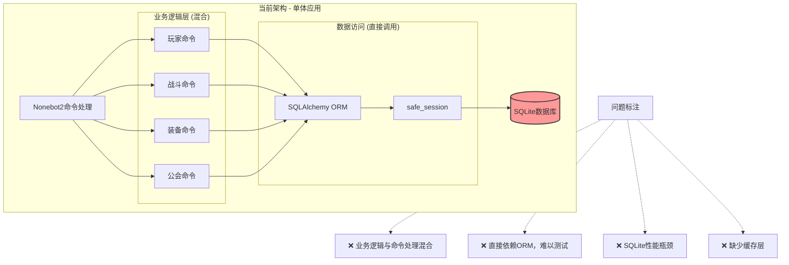

### 1.2 新架构 (重构后)

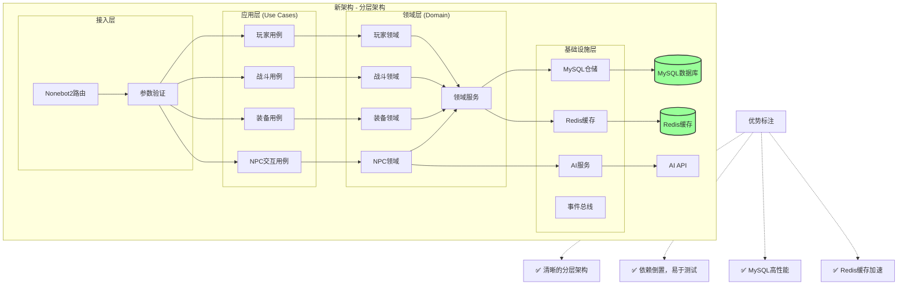

---

## 2. 核心系统详细设计

### 2.1 属性计算系统

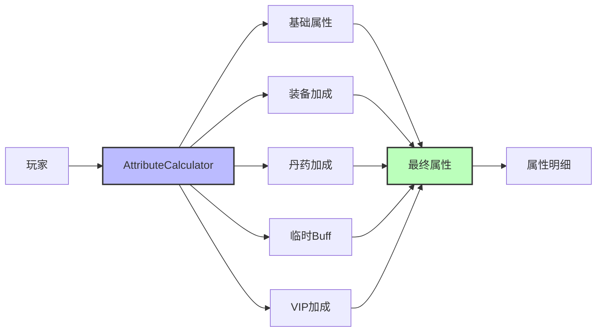

### 2.2 装备效果系统

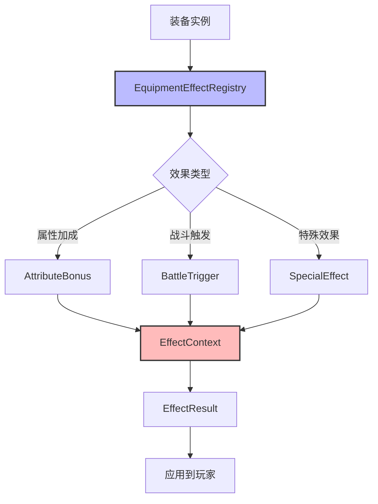

### 2.3 NPC AI Agent系统

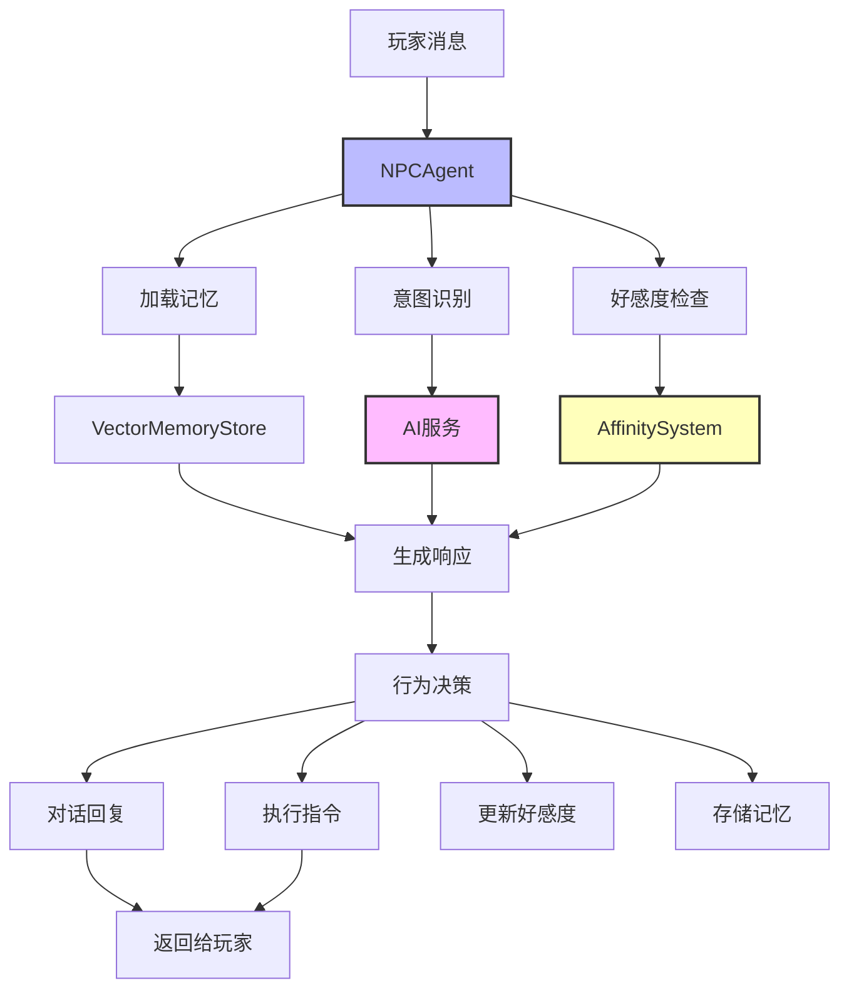

---

## 3. 数据流图

### 3.1 玩家战斗流程

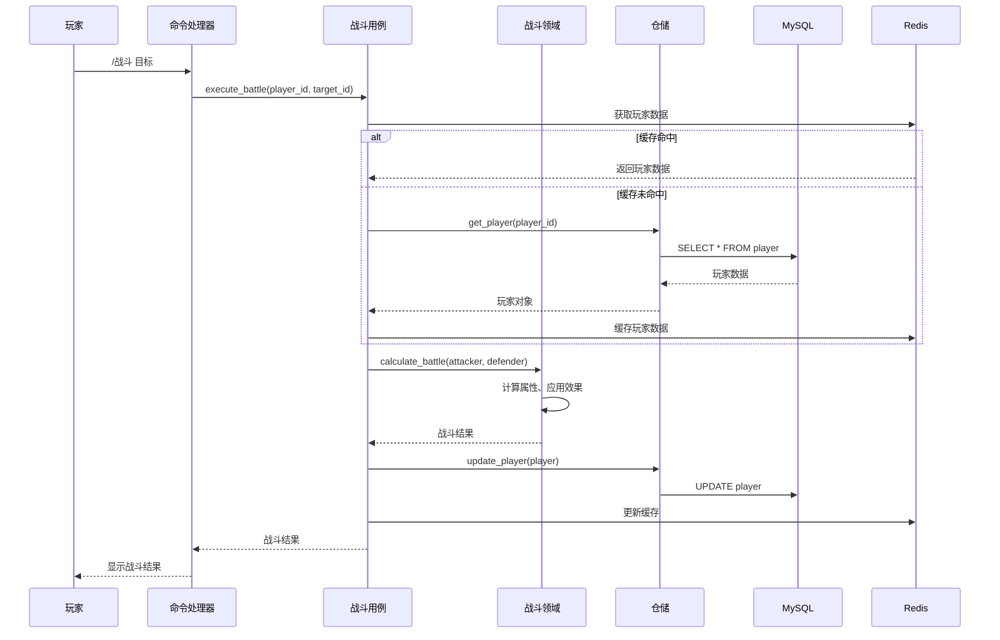

### 3.2 NPC对话流程

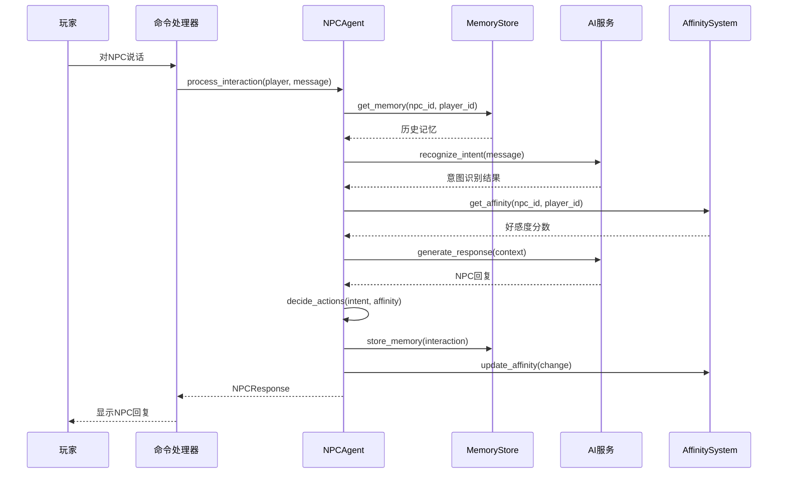

---

## 4. 数据库设计

### 4.1 核心表关系图

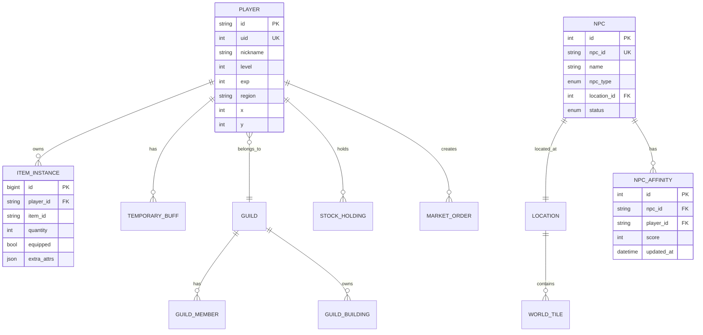

### 4.2 索引策略

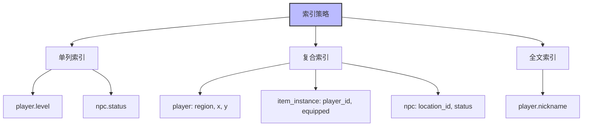

---

## 5. 部署架构

### 5.1 单机部署 (初期)

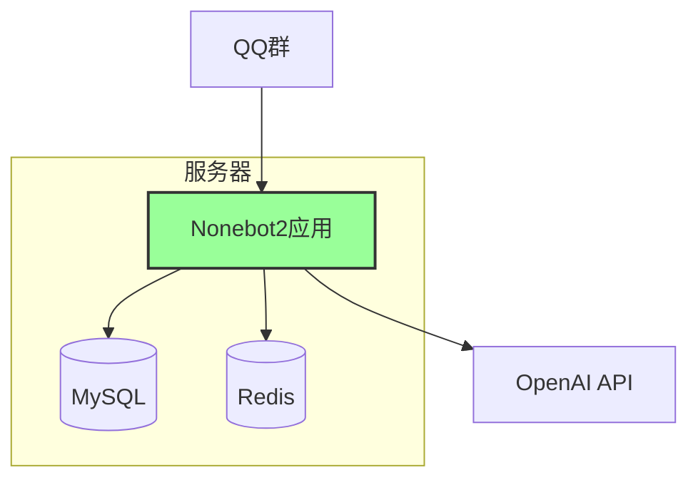

### 5.2 分布式部署 (后期)

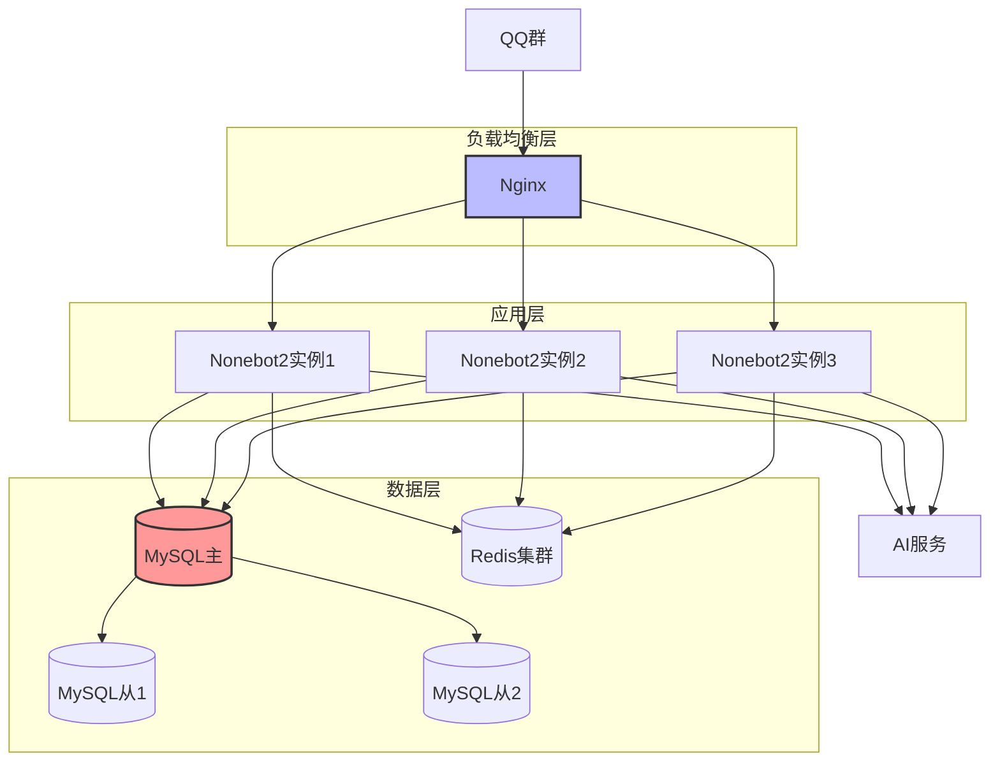

---

## 6. 监控架构

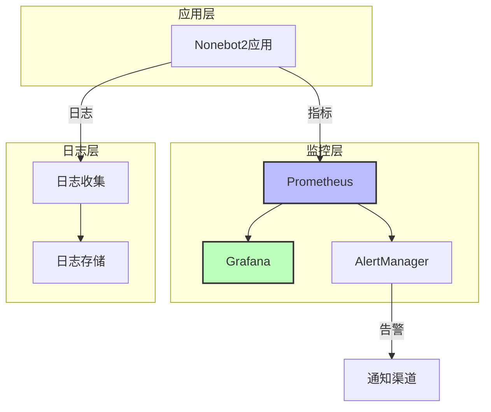

---

**文档结束**

