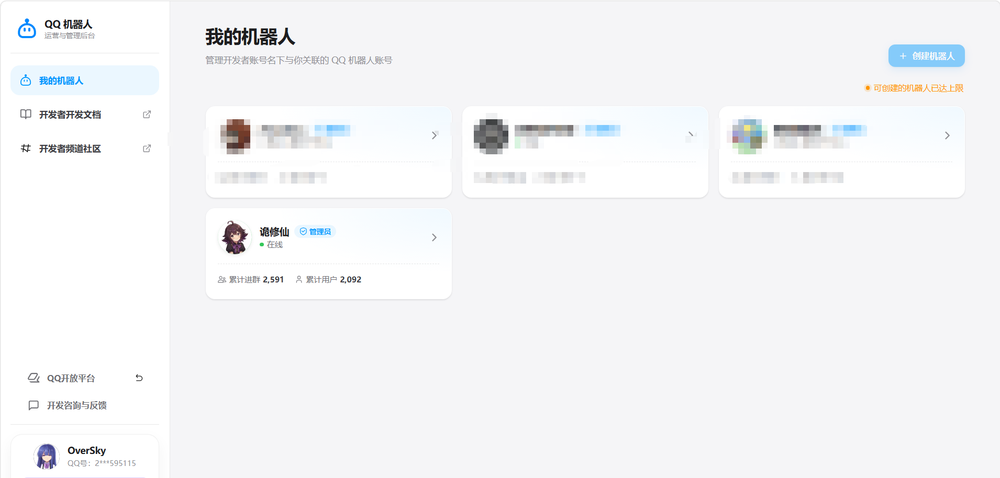
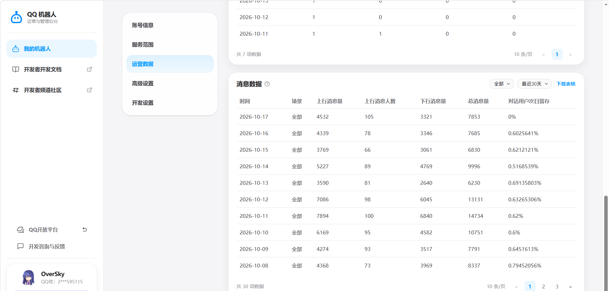
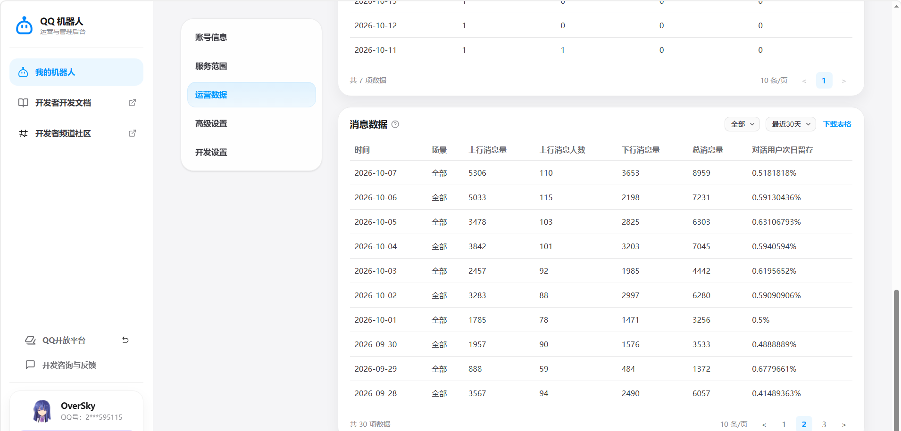

# 诡修仙（GuiXiuXian）· QQ 群文字修仙 RPG 机器人

> ⚠️ **本仓库是公开脱敏版，仅供求职面试时查阅代码使用。**
>
> - 正式运营版本在私有仓库中维护，本仓库只是它的一份展示副本，不会随正式版实时更新。
> - API 密钥、机器人凭据、服务器信息等已全部替换为 `***REMOVED***`，**无法直接运行**。
> - **保留所有权利（All Rights Reserved）。** 未经作者书面许可，禁止将本仓库的代码、配置、文案、剧本、美术资源用于任何商业用途，禁止二次开发、修改后发布、部署运营或转载。详见 [LICENSE](./LICENSE)。

## 项目简介

一个运行在 QQ 群里的修仙题材文字 RPG。玩家在群里发指令修炼、突破、打 Boss、组公会，也可以在交易市场挂单、参与拍卖、互发红包。

- 2025 年 2 月上线，持续运营至今；累计进群 2,591 个，累计用户 2,092 人
- 近 20 天每天给机器人发消息的玩家数在 59~115 之间，日均约 90（数据见下方后台截图）
- 本人独立开发与运营：需求设计、开发、上线、运营与线上问题处理
- 550+ 条指令，2500+ 次提交，104 个测试文件

## 运营数据（QQ 机器人开发者后台截图，2026-10-18）

累计进群与累计用户：

近 20 天的消息数据。"上行消息人数"是当天给机器人发过消息的玩家数，可以看作日活：

> 截图左下角是本人的开发者账号，可证明机器人归属；同一账号下的其他机器人已打码。

## 技术栈

`Python 3.10+` `NoneBot2` `SQLAlchemy 2.0（异步）` `MySQL` `Redis` `APScheduler` `FastAPI`

## 代码导览

| 想看什么 | 位置 |
|---|---|
| 系统技术文档入口 | `llmdoc/index.md` |
| 事务边界与加锁约定 | `plugins/xiuxian_game/models/db.py`、`plugins/xiuxian_game/infrastructure/locking.py` |
| 红包：Redis + Lua 判资格扣份额、Stream 异步入账、过期退款与对账 | `plugins/xiuxian_game/social/red_envelope_store.py`（Lua 脚本）、`red_envelope_settlement.py`（入账、退款、对账）、`red_envelope.py`（指令）；设计说明见 `llmdoc/guides/redis-guide.md` |
| 交易市场（订单簿撮合） | `plugins/xiuxian_game/economy/market.py`、`plugins/xiuxian_game/infrastructure/repositories/market_order_repository.py` |
| 地图快照缓存（Redis + 回源加锁） | `plugins/xiuxian_game/web/map_cache.py` |
| 世界 Boss 伤害排行（Redis ZSet，提交后写绝对值、中途转生搬段、MySQL 重建） | `plugins/xiuxian_game/world_boss/ranking_store.py`、`world_boss/service.py` |
| 签到日历（Redis BitMap） | `plugins/xiuxian_game/entertainment/sign_calendar.py` |
| 基于 Redis 的滑动窗口限流 | `plugins/xiuxian_game/infrastructure/shared_rate_limiter.py` |
| QQ 回调事件去重 | `plugins/xiuxian_game/message_guard.py` |
| 指令分发优化 | `plugins/xiuxian_game/command_dispatch.py` |
| 测试 | `tests/` |

## 关于 AI 辅助开发

项目开发过程中大量使用了 AI 编程工具，部分提交说明中保留了 AI 协作者署名。需求、设计取舍、上线运营与验收由本人负责。

## 第三方组件

以下组件不属于本人原创，仍遵循其各自的许可证，上面的"保留所有权利"不适用于它们：

- `plugins/xiuxian_game/rule_horror/`：规则怪谈玩法，MIT 许可证，见该目录下的 `LICENSE`
- `plugins/xiuxian_game/entertainment/life_restart/`：人生重开模拟器小游戏，其事件与天赋数据来自原开源项目
- 依赖库见 `pyproject.toml`，各自遵循其许可证

## 授权联系

如需授权使用，请联系 seuoversky@qq.com。
