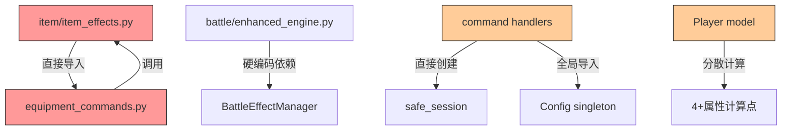
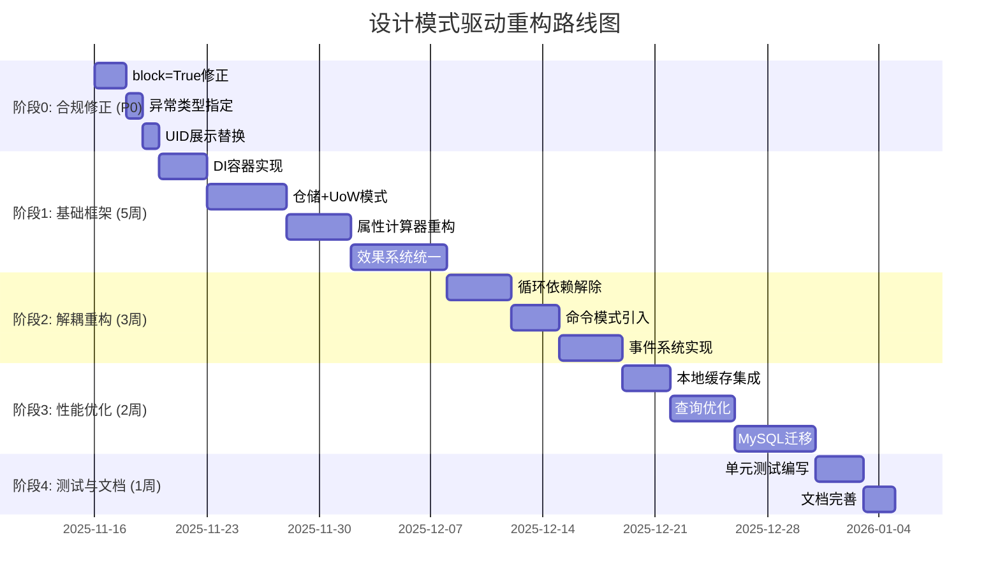
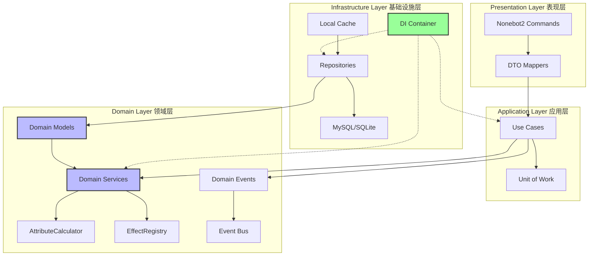

# 诡修仙游戏重构规划文档 v3.0 - 设计模式驱动重构

> **项目名称**: 诡修仙 (GuiXiuXian2)
> **文档版本**: v3.0 (基于最新代码调研的改进版)
> **创建日期**: 2025-11-15
> **文档类型**: 松耦合、易扩展架构重构规划

---

## 📋 执行摘要

基于对最新代码库的深度调研,本文档提出了一套**以设计模式为驱动**的重构方案,旨在实现:
- **松耦合**: 通过依赖注入和接口抽象解耦模块
- **易扩展**: 使用策略/工厂/责任链模式支持功能扩展
- **可测试**: 分离核心逻辑与框架依赖
- **可维护**: 清晰的分层架构和单一职责原则

---

## 📊 目录

1. [核心问题诊断](#1-核心问题诊断)
2. [设计模式解决方案](#2-设计模式解决方案)
3. [重构实施路线图](#3-重构实施路线图)
4. [详细设计方案](#4-详细设计方案)
5. [实施指南](#5-实施指南)

---

## 1. 核心问题诊断

### 1.1 架构问题汇总表

| 问题类别 | 具体表现 | 影响范围 | 严重程度 |
|---------|---------|---------|---------|
| **属性计算分散** | 4+处属性计算逻辑 (player.py:218, BattleAttributeCalculator, item effects, buff system) | 战斗/装备/buff系统 | 🔴 高 |
| **循环依赖** | item_effects.py ↔ equipment_commands.py | 物品/装备模块 | 🔴 高 |
| **无依赖注入** | 全局导入 safe_session, config singleton | 全项目 | 🟠 中 |
| **会话管理混乱** | 3种会话模式并存,无统一边界 | 数据访问层 | 🟠 中 |
| **效果系统重复** | 装饰器注册 vs 管理器模式 | 物品/战斗系统 | 🟡 低 |
| **缺少抽象接口** | 服务类无Protocol/ABC约束 | 全项目 | 🟠 中 |

### 1.2 代码耦合图谱



---

## 2. 设计模式解决方案

### 2.1 依赖注入容器 (Dependency Injection Container)

**问题**: 硬编码依赖导致测试困难,模块间紧耦合

**解决方案**: 引入轻量级DI容器

```python
# infrastructure/di/container.py
from typing import Dict, Type, Callable, Any
from dataclasses import dataclass

@dataclass
class ServiceDescriptor:
    service_type: Type
    implementation: Callable
    lifetime: str  # singleton, scoped, transient

class DIContainer:
    """依赖注入容器"""

    def __init__(self):
        self._services: Dict[Type, ServiceDescriptor] = {}
        self._singletons: Dict[Type, Any] = {}

    def register_singleton(self, service_type: Type, factory: Callable):
        """注册单例服务"""
        self._services[service_type] = ServiceDescriptor(
            service_type, factory, "singleton"
        )

    def register_scoped(self, service_type: Type, factory: Callable):
        """注册作用域服务"""
        self._services[service_type] = ServiceDescriptor(
            service_type, factory, "scoped"
        )

    def register_transient(self, service_type: Type, factory: Callable):
        """注册瞬时服务"""
        self._services[service_type] = ServiceDescriptor(
            service_type, factory, "transient"
        )

    def resolve(self, service_type: Type) -> Any:
        """解析服务实例"""
        descriptor = self._services.get(service_type)
        if not descriptor:
            raise ValueError(f"Service {service_type} not registered")

        if descriptor.lifetime == "singleton":
            if service_type not in self._singletons:
                self._singletons[service_type] = descriptor.implementation(self)
            return self._singletons[service_type]

        elif descriptor.lifetime == "transient":
            return descriptor.implementation(self)

        else:  # scoped
            # 从作用域上下文获取 (简化版)
            return descriptor.implementation(self)

# 使用示例
container = DIContainer()

# 注册服务
container.register_singleton(IPlayerRepository, lambda c: PlayerRepository(c.resolve(AsyncSession)))
container.register_scoped(AsyncSession, lambda c: create_session())
container.register_transient(AttributeCalculator, lambda c: AttributeCalculator())

# 解析使用
player_repo = container.resolve(IPlayerRepository)
```

**优点**:
- ✅ 解耦模块依赖
- ✅ 支持接口注入,易于测试
- ✅ 集中管理依赖生命周期

### 2.2 仓储模式 + 工作单元 (Repository + Unit of Work)

**问题**: 会话管理混乱,事务边界不清

**解决方案**: Repository管理查询,UoW管理事务

```python
# domain/repositories/base.py
from abc import ABC, abstractmethod
from typing import Generic, TypeVar, Optional, List

T = TypeVar('T')

class IRepository(ABC, Generic[T]):
    """仓储接口"""

    @abstractmethod
    async def get_by_id(self, id: Any) -> Optional[T]:
        pass

    @abstractmethod
    async def add(self, entity: T) -> T:
        pass

    @abstractmethod
    async def update(self, entity: T) -> T:
        pass

    @abstractmethod
    async def delete(self, id: Any) -> bool:
        pass

# infrastructure/repositories/player_repository.py
class PlayerRepository(IRepository[Player]):
    """玩家仓储实现"""

    def __init__(self, session: AsyncSession):
        self._session = session  # 由外部注入,不内部创建

    async def get_by_id(self, player_id: str) -> Optional[Player]:
        stmt = select(Player).where(Player.id == player_id)
        result = await self._session.execute(stmt)
        return result.scalar_one_or_none()

    async def get_nearby_players(
        self, x: int, y: int, region: str, max_distance: int
    ) -> List[Player]:
        """优化的附近玩家查询 - 使用边界框+索引"""
        stmt = select(Player).where(
            and_(
                Player.region == region,
                Player.x.between(x - max_distance, x + max_distance),
                Player.y.between(y - max_distance, y + max_distance)
            )
        )
        result = await self._session.execute(stmt)
        players = result.scalars().all()

        # 后过滤: 曼哈顿距离
        return [
            p for p in players
            if abs(p.x - x) + abs(p.y - y) <= max_distance
        ]

# infrastructure/uow/unit_of_work.py
class UnitOfWork:
    """工作单元 - 管理事务边界"""

    def __init__(self, session_factory: Callable[[], AsyncSession]):
        self._session_factory = session_factory
        self._session: Optional[AsyncSession] = None

        # 仓储实例
        self.players: Optional[PlayerRepository] = None
        self.items: Optional[ItemRepository] = None
        self.guilds: Optional[GuildRepository] = None

    async def __aenter__(self):
        self._session = self._session_factory()

        # 创建仓储实例,注入同一session
        self.players = PlayerRepository(self._session)
        self.items = ItemRepository(self._session)
        self.guilds = GuildRepository(self._session)

        return self

    async def __aexit__(self, exc_type, exc_val, exc_tb):
        if exc_type:
            await self._session.rollback()
        else:
            await self._session.commit()

        await self._session.close()

    async def commit(self):
        await self._session.commit()

    async def rollback(self):
        await self._session.rollback()

# 使用示例
async def cultivate_use_case(player_id: str, hours: int):
    """修炼用例 - 明确的事务边界"""
    async with UnitOfWork(session_factory) as uow:
        # 查询
        player = await uow.players.get_by_id(player_id)
        if not player:
            raise PlayerNotFoundError()

        # 业务逻辑
        exp_gain = calculate_exp_gain(player, hours)
        player.exp += exp_gain

        # 更新
        await uow.players.update(player)

        # 提交事务 (或退出上下文自动提交)
        await uow.commit()
```

**优点**:
- ✅ 统一的事务边界
- ✅ 会话生命周期清晰
- ✅ 仓储接口易于mock测试

### 2.3 策略模式统一效果系统 (Strategy Pattern)

**问题**: 装备效果和战斗效果设计不一致,难以扩展

**解决方案**: 统一效果接口+策略注册表

```python
# domain/effects/effect_interface.py
from abc import ABC, abstractmethod
from enum import Enum

class TriggerType(Enum):
    """触发类型"""
    PASSIVE = "passive"          # 被动
    ON_ATTACK = "on_attack"      # 攻击时
    ON_DEFEND = "on_defend"      # 防御时
    ON_SKILL = "on_skill"        # 技能释放时
    TURN_START = "turn_start"    # 回合开始
    TURN_END = "turn_end"        # 回合结束

@dataclass
class EffectContext:
    """效果执行上下文"""
    trigger_type: TriggerType
    source: Any  # 效果来源 (装备/技能/buff)
    target: Player
    battle_state: Optional[BattleState] = None
    damage_dealt: Optional[int] = None

@dataclass
class EffectResult:
    """效果执行结果"""
    success: bool
    message: str
    attribute_changes: Dict[str, int] = field(default_factory=dict)
    status_changes: List[str] = field(default_factory=list)

class IEffect(ABC):
    """效果接口 - 所有效果的统一抽象"""

    @abstractmethod
    def can_trigger(self, context: EffectContext) -> bool:
        """判断是否可以触发"""
        pass

    @abstractmethod
    async def execute(self, context: EffectContext) -> EffectResult:
        """执行效果"""
        pass

    @property
    @abstractmethod
    def effect_id(self) -> str:
        """效果唯一标识"""
        pass

# domain/effects/effect_registry.py
class EffectRegistry:
    """效果注册表 - 管理所有效果"""

    def __init__(self):
        self._effects: Dict[str, IEffect] = {}

    def register(self, effect: IEffect):
        """注册效果"""
        self._effects[effect.effect_id] = effect

    def get(self, effect_id: str) -> Optional[IEffect]:
        """获取效果"""
        return self._effects.get(effect_id)

    def get_by_trigger(self, trigger_type: TriggerType) -> List[IEffect]:
        """获取特定触发类型的所有效果"""
        return [
            effect for effect in self._effects.values()
            if isinstance(effect, TriggeredEffect) and effect.trigger_type == trigger_type
        ]

# 装饰器注册
def register_effect(effect_id: str):
    """效果注册装饰器"""
    def decorator(cls: Type[IEffect]):
        # 自动注册到全局注册表
        effect_registry.register(cls())
        return cls
    return decorator

# 具体效果实现示例
@register_effect("lifesteal")
class LifestealEffect(IEffect):
    """吸血效果"""

    def __init__(self, rate: float = 0.2):
        self.rate = rate

    @property
    def effect_id(self) -> str:
        return "lifesteal"

    def can_trigger(self, context: EffectContext) -> bool:
        return (
            context.trigger_type == TriggerType.ON_ATTACK
            and context.damage_dealt is not None
            and context.damage_dealt > 0
        )

    async def execute(self, context: EffectContext) -> EffectResult:
        heal_amount = int(context.damage_dealt * self.rate)
        context.target.hp = min(
            context.target.hp + heal_amount,
            context.target.max_hp
        )

        return EffectResult(
            success=True,
            message=f"吸血回复{heal_amount}点生命",
            attribute_changes={"hp": heal_amount}
        )

@register_effect("counterattack")
class CounterattackEffect(IEffect):
    """反击效果"""

    @property
    def effect_id(self) -> str:
        return "counterattack"

    def can_trigger(self, context: EffectContext) -> bool:
        return context.trigger_type == TriggerType.ON_DEFEND

    async def execute(self, context: EffectContext) -> EffectResult:
        # 实现反击逻辑
        pass
```

**迁移策略**:
1. 创建效果接口和注册表
2. 将现有装备效果适配到新接口 (Adapter模式)
3. 将战斗效果重构为策略实现
4. 逐步替换旧代码引用

**优点**:
- ✅ 统一的效果管理
- ✅ 易于添加新效果 (开闭原则)
- ✅ 效果组合灵活 (责任链模式)

### 2.4 属性计算器统一 (Single Responsibility + Composite)

**问题**: 属性计算分散在4+处,难以维护

**解决方案**: 单一属性计算器+组合模式

```python
# domain/attributes/attribute_calculator.py
from dataclasses import dataclass
from typing import Protocol

@dataclass
class AttributeBonus:
    """属性加成"""
    attack: int = 0
    defense: int = 0
    hp: int = 0
    mp: int = 0
    agility: int = 0
    # ... 其他属性

@dataclass
class AttributeBreakdown:
    """属性明细 - 用于调试和展示"""
    base: AttributeBonus
    equipment: AttributeBonus
    buff: AttributeBonus
    elixir: AttributeBonus
    vip: AttributeBonus
    total: AttributeBonus

class IAttributeSource(Protocol):
    """属性来源接口"""
    async def calculate_bonus(self, player: Player) -> AttributeBonus:
        """计算属性加成"""
        ...

class AttributeCalculator:
    """统一属性计算器 - 单一职责"""

    def __init__(self):
        self._sources: List[IAttributeSource] = []

    def add_source(self, source: IAttributeSource):
        """添加属性来源"""
        self._sources.append(source)

    async def calculate_final_attributes(
        self, player: Player
    ) -> AttributeBreakdown:
        """计算最终属性 - 组合所有来源"""
        base = await self._calculate_base(player)

        # 并发计算各来源加成
        sources_bonuses = await asyncio.gather(*[
            source.calculate_bonus(player) for source in self._sources
        ])

        # 汇总
        total = self._sum_bonuses([base] + sources_bonuses)

        return AttributeBreakdown(
            base=base,
            equipment=sources_bonuses[0] if len(sources_bonuses) > 0 else AttributeBonus(),
            buff=sources_bonuses[1] if len(sources_bonuses) > 1 else AttributeBonus(),
            elixir=sources_bonuses[2] if len(sources_bonuses) > 2 else AttributeBonus(),
            vip=sources_bonuses[3] if len(sources_bonuses) > 3 else AttributeBonus(),
            total=total
        )

    async def _calculate_base(self, player: Player) -> AttributeBonus:
        """计算基础属性"""
        return AttributeBonus(
            attack=player.base_attack,
            defense=player.base_defense,
            hp=player.base_hp,
            mp=player.base_mp,
            agility=player.base_agility
        )

    def _sum_bonuses(self, bonuses: List[AttributeBonus]) -> AttributeBonus:
        """汇总属性加成"""
        return AttributeBonus(
            attack=sum(b.attack for b in bonuses),
            defense=sum(b.defense for b in bonuses),
            hp=sum(b.hp for b in bonuses),
            mp=sum(b.mp for b in bonuses),
            agility=sum(b.agility for b in bonuses)
        )

# 具体属性来源实现
class EquipmentAttributeSource(IAttributeSource):
    """装备属性来源"""

    def __init__(self, item_repo: IItemRepository):
        self._item_repo = item_repo

    async def calculate_bonus(self, player: Player) -> AttributeBonus:
        # 查询玩家装备
        equipped_items = await self._item_repo.get_equipped_items(player.id)

        # 汇总装备属性
        total = AttributeBonus()
        for item in equipped_items:
            total.attack += item.attack_bonus
            total.defense += item.defense_bonus
            # ...

        return total

class BuffAttributeSource(IAttributeSource):
    """buff属性来源"""

    def __init__(self, buff_repo: IBuffRepository):
        self._buff_repo = buff_repo

    async def calculate_bonus(self, player: Player) -> AttributeBonus:
        buffs = await self._buff_repo.get_active_buffs(player.id)

        total = AttributeBonus()
        for buff in buffs:
            total.attack += buff.attack_bonus
            total.defense += buff.defense_bonus
            # ...

        return total

# 使用示例
calculator = AttributeCalculator()
calculator.add_source(EquipmentAttributeSource(item_repo))
calculator.add_source(BuffAttributeSource(buff_repo))
calculator.add_source(ElixirAttributeSource(elixir_repo))
calculator.add_source(VIPAttributeSource(vip_service))

breakdown = await calculator.calculate_final_attributes(player)
print(f"总攻击力: {breakdown.total.attack}")
print(f"  基础: {breakdown.base.attack}")
print(f"  装备: {breakdown.equipment.attack}")
print(f"  buff: {breakdown.buff.attack}")
```

**优点**:
- ✅ 单一计算入口
- ✅ 属性来源可扩展 (开闭原则)
- ✅ 支持属性追溯 (调试友好)
- ✅ 易于测试 (mock各来源)

### 2.5 命令模式解耦NPC行为 (Command Pattern)

**问题**: NPC行为执行与战斗系统耦合 (REFACTORING_PLAN.md line 1743直接导入EnhancedBattleEngine)

**解决方案**: 命令模式+接口注入

```python
# domain/npc/commands/command_interface.py
from abc import ABC, abstractmethod

@dataclass
class CommandContext:
    """命令执行上下文"""
    executor: Any  # NPC或Player
    target: Optional[Any] = None
    params: Dict[str, Any] = field(default_factory=dict)

@dataclass
class CommandResult:
    """命令执行结果"""
    success: bool
    message: str
    data: Dict[str, Any] = field(default_factory=dict)

class ICommand(ABC):
    """命令接口"""

    @abstractmethod
    async def execute(self, context: CommandContext) -> CommandResult:
        """执行命令"""
        pass

    @abstractmethod
    def can_execute(self, context: CommandContext) -> bool:
        """判断是否可执行"""
        pass

# domain/npc/commands/attack_command.py
class AttackCommand(ICommand):
    """攻击命令"""

    def __init__(self, battle_engine: IBattleEngine):  # 依赖接口
        self._battle_engine = battle_engine

    def can_execute(self, context: CommandContext) -> bool:
        return context.target is not None

    async def execute(self, context: CommandContext) -> CommandResult:
        # 使用注入的战斗引擎接口
        battle_result = await self._battle_engine.start_battle(
            attacker=context.executor,
            defender=context.target
        )

        return CommandResult(
            success=True,
            message=f"战斗完成,{battle_result.winner}获胜",
            data={"battle_log": battle_result.log}
        )

# domain/battle/interfaces.py
class IBattleEngine(Protocol):
    """战斗引擎接口 - 供NPC等系统依赖"""
    async def start_battle(self, attacker: Any, defender: Any) -> BattleResult:
        ...

# infrastructure/battle/enhanced_engine.py
class EnhancedBattleEngine(IBattleEngine):
    """战斗引擎实现"""

    async def start_battle(self, attacker: Any, defender: Any) -> BattleResult:
        # 具体实现
        pass

# domain/npc/npc_command_executor.py
class NPCCommandExecutor:
    """NPC命令执行器"""

    def __init__(self, command_registry: Dict[str, ICommand]):
        self._commands = command_registry  # 通过DI注入命令

    async def execute_command(
        self, command_name: str, context: CommandContext
    ) -> CommandResult:
        command = self._commands.get(command_name)
        if not command:
            return CommandResult(success=False, message=f"未知命令: {command_name}")

        if not command.can_execute(context):
            return CommandResult(success=False, message="命令无法执行")

        return await command.execute(context)

# DI容器配置
container.register_singleton(
    IBattleEngine,
    lambda c: EnhancedBattleEngine()
)

container.register_transient(
    AttackCommand,
    lambda c: AttackCommand(c.resolve(IBattleEngine))
)

command_registry = {
    "攻击": container.resolve(AttackCommand),
    "修炼": container.resolve(CultivateCommand),
    # ...
}

executor = NPCCommandExecutor(command_registry)
```

**优点**:
- ✅ NPC与战斗系统解耦 (依赖接口)
- ✅ 命令可扩展 (注册新命令)
- ✅ 易于测试 (mock命令)

### 2.6 观察者模式实现事件系统 (Observer Pattern)

**问题**: 缺少领域事件,副作用逻辑散落各处

**解决方案**: 事件发布/订阅机制

```python
# domain/events/event_bus.py
from typing import Callable, List
from dataclasses import dataclass
from abc import ABC

@dataclass
class DomainEvent(ABC):
    """领域事件基类"""
    timestamp: datetime = field(default_factory=datetime.now)

@dataclass
class PlayerLevelUpEvent(DomainEvent):
    """玩家升级事件"""
    player_id: str
    old_level: int
    new_level: int

@dataclass
class ItemUsedEvent(DomainEvent):
    """物品使用事件"""
    player_id: str
    item_id: str
    quantity: int

class EventBus:
    """事件总线"""

    def __init__(self):
        self._handlers: Dict[Type[DomainEvent], List[Callable]] = {}

    def subscribe(self, event_type: Type[DomainEvent], handler: Callable):
        """订阅事件"""
        if event_type not in self._handlers:
            self._handlers[event_type] = []
        self._handlers[event_type].append(handler)

    async def publish(self, event: DomainEvent):
        """发布事件"""
        event_type = type(event)
        handlers = self._handlers.get(event_type, [])

        # 并发执行所有处理器
        await asyncio.gather(*[handler(event) for handler in handlers])

# 事件处理器示例
async def on_player_level_up(event: PlayerLevelUpEvent):
    """玩家升级事件处理器"""
    # 发放升级奖励
    await reward_service.grant_level_up_reward(event.player_id, event.new_level)

    # 更新排行榜缓存失效
    await cache.invalidate("leaderboard")

    # 通知公会成员 (拉取式: 存入event_store)
    player = await player_repo.get_by_id(event.player_id)
    if player.guild_id:
        await event_store.add_guild_event(
            player.guild_id,
            f"{player.nickname}突破至{event.new_level}级!"
        )

# 注册事件处理器
event_bus.subscribe(PlayerLevelUpEvent, on_player_level_up)

# 使用示例
async def cultivate_breakthrough(player: Player):
    old_level = player.level
    player.level += 1

    await player_repo.update(player)

    # 发布领域事件
    await event_bus.publish(PlayerLevelUpEvent(
        player_id=player.id,
        old_level=old_level,
        new_level=player.level
    ))
```

**优点**:
- ✅ 解耦副作用逻辑
- ✅ 支持多个订阅者
- ✅ 易于添加新功能 (订阅事件即可)

---

## 3. 重构实施路线图

### 3.1 四阶段渐进式重构



### 3.2 优先级矩阵

| 任务 | 价值 | 难度 | 优先级 | 说明 |
|-----|------|------|--------|------|
| **合规修正** | 🔴 | 🟢 | P0 | 强制要求,必须最先完成 |
| **属性计算器** | 🔴 | 🟠 | P0 | 解决核心分散问题 |
| **效果系统统一** | 🔴 | 🔴 | P0 | 解决设计不一致 |
| **DI容器** | 🟠 | 🟡 | P1 | 解耦基础 |
| **仓储+UoW** | 🟠 | 🟠 | P1 | 会话管理统一 |
| **循环依赖解除** | 🟠 | 🟡 | P1 | 提升可维护性 |
| **本地缓存** | 🟡 | 🟢 | P1 | 性能快赢 |
| **命令模式** | 🟡 | 🟠 | P2 | NPC扩展性 |
| **事件系统** | 🟡 | 🟠 | P2 | 解耦副作用 |
| **MySQL迁移** | 🟡 | 🔴 | P2 | 并发性能 |

---

## 4. 详细设计方案

### 4.1 目标架构图



### 4.2 关键模块重构详情

#### 4.2.1 属性系统重构

**当前状态** (分散在4+处):
- `plugins/xiuxian_game/models/player.py:218-256` - get_effective_attributes
- `plugins/xiuxian_game/battle/battle_attributes.py` - BattleAttributeCalculator
- `plugins/xiuxian_game/item/item_effects.py` - 装备效果计算
- `plugins/xiuxian_game/models/temporary_buff.py` - Buff加成计算

**目标状态** (统一入口):
```
domain/attributes/
├── attribute_calculator.py      # 主计算器
├── attribute_sources/
│   ├── base_source.py           # 基础属性
│   ├── equipment_source.py      # 装备加成
│   ├── buff_source.py           # Buff加成
│   ├── elixir_source.py         # 丹药加成
│   └── vip_source.py            # VIP加成
└── interfaces.py                # IAttributeSource接口
```

**迁移步骤**:
1. 创建AttributeCalculator和接口
2. 实现各AttributeSource (适配现有逻辑)
3. 更新Player模型使用新计算器
4. 更新战斗系统使用新计算器
5. 删除旧的分散计算逻辑

#### 4.2.2 效果系统重构

**当前状态** (两套系统):
- `plugins/xiuxian_game/item/item_effects.py` - 装饰器注册
- `plugins/xiuxian_game/battle/battle_effects.py` - 管理器模式

**目标状态** (统一接口):
```
domain/effects/
├── effect_interface.py          # IEffect接口
├── effect_registry.py           # 统一注册表
├── equipment_effects/           # 装备效果
│   ├── lifesteal.py
│   ├── counterattack.py
│   └── ...
├── battle_effects/              # 战斗效果
│   ├── stun.py
│   ├── poison.py
│   └── ...
└── buff_effects/                # Buff效果
    ├── attack_boost.py
    └── ...
```

**适配器模式迁移**:
```python
# 适配器: 将旧效果适配到新接口
class LegacyItemEffectAdapter(IEffect):
    """旧物品效果适配器"""

    def __init__(self, legacy_handler: Callable):
        self._legacy_handler = legacy_handler

    async def execute(self, context: EffectContext) -> EffectResult:
        # 转换上下文格式
        legacy_result = await self._legacy_handler(
            player=context.target,
            item=context.source
        )
        # 转换结果格式
        return EffectResult(
            success=True,
            message=legacy_result
        )
```

#### 4.2.3 循环依赖解除

**问题代码** (item_effects.py ↔ equipment_commands.py):
```python
# item/item_effects.py (line 13)
from .equipment_commands import recalc_equipment_attributes  # ❌ 循环依赖

async def apply_equipment_effect(player: Player):
    # ...
    await recalc_equipment_attributes(player)  # 直接调用
```

**解决方案** (依赖注入+事件):
```python
# domain/equipment/equipment_service.py
class EquipmentService:
    def __init__(self, event_bus: EventBus):
        self._event_bus = event_bus

    async def apply_equipment_effect(self, player: Player, item: Item):
        # 应用效果
        player.attack += item.attack_bonus

        # 发布事件,而非直接调用重算
        await self._event_bus.publish(EquipmentChangedEvent(
            player_id=player.id
        ))

# application/event_handlers/equipment_handlers.py
async def on_equipment_changed(event: EquipmentChangedEvent):
    """装备变化事件处理器"""
    # 重新计算属性
    calculator = container.resolve(AttributeCalculator)
    player = await player_repo.get_by_id(event.player_id)

    breakdown = await calculator.calculate_final_attributes(player)
    # 更新玩家缓存属性
    player.cached_attack = breakdown.total.attack
    await player_repo.update(player)

# 注册事件
event_bus.subscribe(EquipmentChangedEvent, on_equipment_changed)
```

---

## 5. 实施指南

### 5.1 风险控制策略

| 风险 | 缓解措施 | 应急预案 |
|-----|---------|---------|
| **破坏现有功能** | 1. 并行开发新旧代码<br>2. Feature Flag控制切换<br>3. 完整回归测试 | 立即回滚Feature Flag |
| **性能回归** | 1. 性能基准测试<br>2. 灰度发布<br>3. 监控关键指标 | 降级到旧实现 |
| **测试覆盖不足** | 1. 核心逻辑测试优先<br>2. 测试先行TDD<br>3. Mock框架隔离依赖 | 延长测试周期 |

### 5.2 测试策略

#### 单元测试示例 (核心逻辑)
```python
# tests/unit/test_attribute_calculator.py
import pytest
from domain.attributes.attribute_calculator import AttributeCalculator
from domain.attributes.attribute_sources import EquipmentAttributeSource

@pytest.mark.asyncio
async def test_attribute_calculator():
    """测试属性计算器 - 不依赖Nonebot"""
    # Mock仓储
    mock_item_repo = MockItemRepository()
    mock_item_repo.set_equipped_items([
        MockItem(attack_bonus=10, defense_bonus=5)
    ])

    # 创建计算器
    calculator = AttributeCalculator()
    calculator.add_source(EquipmentAttributeSource(mock_item_repo))

    # 测试玩家
    player = MockPlayer(base_attack=50, base_defense=30)

    # 执行计算
    breakdown = await calculator.calculate_final_attributes(player)

    # 断言
    assert breakdown.total.attack == 60  # 50 + 10
    assert breakdown.total.defense == 35  # 30 + 5
    assert breakdown.equipment.attack == 10
```

#### 集成测试示例 (仓储层)
```python
# tests/integration/test_player_repository.py
@pytest.fixture
async def test_db():
    """内存数据库"""
    engine = create_async_engine("sqlite+aiosqlite:///:memory:")
    async with engine.begin() as conn:
        await conn.run_sync(Base.metadata.create_all)
    yield engine
    await engine.dispose()

@pytest.mark.asyncio
async def test_player_repository_nearby_query(test_db):
    """测试附近玩家查询优化"""
    async with AsyncSession(test_db) as session:
        repo = PlayerRepository(session)

        # 插入测试数据
        players = [
            Player(id=f"p{i}", x=i, y=i, region="main")
            for i in range(10)
        ]
        for p in players:
            await repo.add(p)
        await session.commit()

        # 查询附近玩家
        nearby = await repo.get_nearby_players(5, 5, "main", max_distance=2)

        # 断言
        assert len(nearby) == 5  # 3,4,5,6,7
```

### 5.3 代码审查清单

每次PR必须检查:
- [ ] 是否使用了DI容器注入依赖 (而非直接import)
- [ ] 是否依赖接口而非具体实现 (DIP原则)
- [ ] 是否使用UoW管理事务边界
- [ ] 是否遵循单一职责原则
- [ ] 是否有对应的单元测试
- [ ] 是否符合合规约束 (block=True, 指定异常类型, UID展示)

### 5.4 渐进式迁移示例

**阶段1: 并行实现**
```python
# 保留旧代码
def old_calculate_attributes(player: Player) -> int:
    # 旧逻辑
    pass

# 新实现
async def new_calculate_attributes(player: Player) -> AttributeBreakdown:
    calculator = container.resolve(AttributeCalculator)
    return await calculator.calculate_final_attributes(player)

# Feature Flag控制
if feature_flags.use_new_attribute_calculator:
    breakdown = await new_calculate_attributes(player)
    attack = breakdown.total.attack
else:
    attack = old_calculate_attributes(player)
```

**阶段2: 灰度验证**
```python
# 双写验证一致性
old_attack = old_calculate_attributes(player)
new_breakdown = await new_calculate_attributes(player)

if abs(old_attack - new_breakdown.total.attack) > 1:
    logger.error(f"属性计算不一致: old={old_attack}, new={new_breakdown.total.attack}")
```

**阶段3: 完全切换**
```python
# 删除旧代码和Feature Flag
breakdown = await new_calculate_attributes(player)
attack = breakdown.total.attack
```

---

## 6. 总结

### 6.1 预期收益

| 指标 | 当前 | 目标 | 提升 |
|-----|------|------|------|
| **循环依赖数** | 2+ | 0 | -100% |
| **属性计算入口** | 4+ | 1 | -75% |
| **效果系统数量** | 2 | 1 | -50% |
| **单元测试覆盖率** | <10% | >80% | +70% |
| **新功能开发时间** | 2-3天 | 0.5-1天 | -60% |

### 6.2 关键成功因素

1. ✅ **合规优先**: 先完成P0合规修正
2. ✅ **小步迭代**: 每次重构一个模块,验证后再继续
3. ✅ **测试保障**: 核心逻辑测试覆盖>80%
4. ✅ **并行开发**: 新旧代码并行,Feature Flag控制
5. ✅ **持续监控**: 关键指标实时监控

### 6.3 后续优化方向

- **P3优化**: Redis缓存 (多实例部署时)
- **P3优化**: MySQL分区表 (历史数据归档)
- **P4扩展**: GraphQL API (前后端分离)
- **P4扩展**: WebSocket (实时对战)

---

**文档版本**: v3.0
**最后更新**: 2025-11-15
**维护者**: Claude Code + 开发团队
