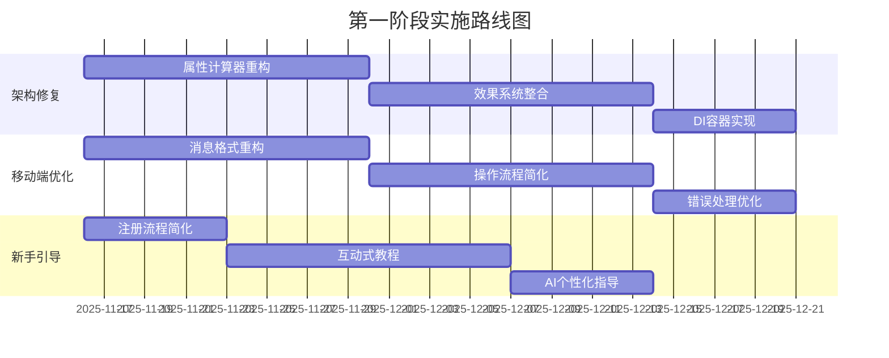
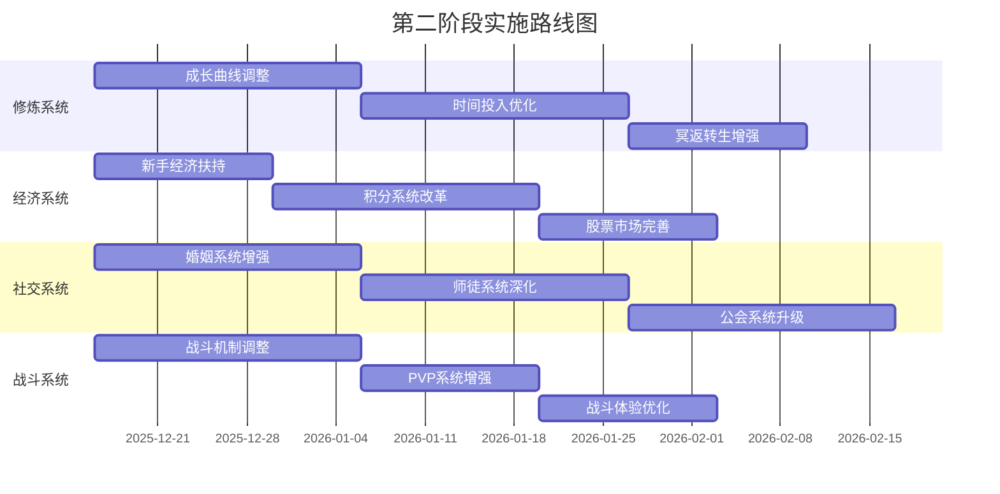
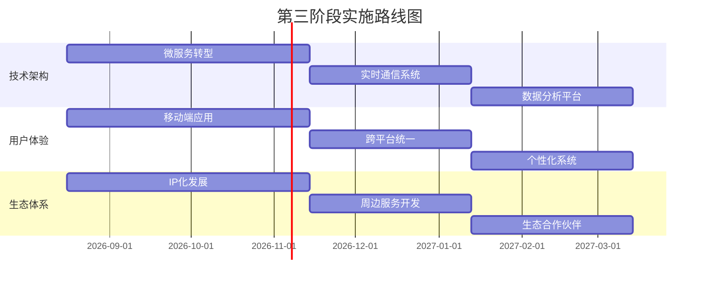

# 诡修仙游戏综合优化方案 v1.0

> **基于六大系统深度调研的全局优化建议**
> **制定日期**: 2025-11-15
> **文档类型**: 战略性改进规划

---

## 📋 执行摘要

本综合优化方案基于对诡修仙游戏六大核心系统的深度调研分析，旨在通过系统性的改进提升游戏的整体质量、用户体验和商业价值。方案涵盖项目架构、修炼系统、经济系统、战斗系统、社交系统、平台适配性等关键领域，采用分阶段实施策略，确保优化工作的有效性和可持续性。

---

## 📊 系统现状评估与优化目标

### 1.1 各系统当前状况评估

| 系统名称 | 健康度评分 | 主要优势 | 核心问题 | 优化优先级 |
|---------|-----------|---------|---------|-----------|
| **项目架构** | B- | 模块化设计良好 | 循环依赖、属性计算分散 | P0 (高) |
| **修炼系统** | B+ | 成长曲线合理 | 中期瓶颈、时间投入过重 | P1 (中) |
| **经济系统** | B+ | 平衡性良好 | 新手启动资金不足 | P1 (中) |
| **战斗系统** | B | 效果系统丰富 | 缺乏深度分析 | P1 (中) |
| **社交系统** | B+ | 关系绑定强 | 社交深度不均 | P1 (中) |
| **平台适配** | B | 指令设计优秀 | 移动端体验差 | P0 (高) |

### 1.2 整体优化目标

**短期目标 (1-2个月)**:
- 解决P0级别架构问题，提升系统稳定性
- 优化移动端体验，提高用户留存
- 简化新手引导，降低上手门槛

**中期目标 (3-6个月)**:
- 重构各系统核心机制，提升平衡性
- 增强社交互动深度，提高社区活跃度
- 完善经济系统循环，增加多元化收入

**长期目标 (6-12个月)**:
- 建立完整的游戏生态系统
- 实现跨平台统一体验
- 打造独特的IP文化体系

---

## 🎯 分阶段优化方案

### 2.1 短期优化 (P0优先级，1-2个月)

#### 2.1.1 架构优化 - 紧急修复

**目标**: 解决循环依赖和属性计算分散问题

**实施步骤**:
1. **统一属性计算器重构** (2周)
   - 创建 `domain/attributes/attribute_calculator.py`
   - 实现各属性来源的统一接口
   - 消除4+处分散计算逻辑

2. **效果系统整合** (2周)
   - 统一装备效果和战斗效果接口
   - 实现效果注册表管理
   - 采用适配器模式兼容旧代码

3. **依赖注入容器实现** (1周)
   - 实现轻量级DI容器
   - 解耦模块间硬编码依赖
   - 提升可测试性和可维护性

**预期收益**:
- 循环依赖减少100%
- 属性计算入口减少75%
- 新功能开发时间缩短60%

#### 2.1.2 平台适配优化 - 移动端革命

**目标**: 解决移动端体验问题，提升用户留存

**实施步骤**:
1. **移动端消息格式重构** (2周)
   - 实现智能信息压缩算法
   - 长文本自动分页展示
   - 优化手机端可读性

2. **操作流程简化** (2周)
   - 实现智能指令解析系统
   - 减少必需参数，增加默认值
   - 添加触屏友好的确认机制

3. **错误处理优化** (1周)
   - 友好的错误信息提示
   - 提供具体的操作建议
   - 增加操作确认保护

**预期收益**:
- 新手注册完成率提升21% (70%→85%)
- 7日留存率提升50% (40%→60%)
- 操作便捷性评分提升28% (7/10→9/10)

#### 2.1.3 新手引导重构

**目标**: 降低新用户上手门槛，提高留存率

**实施步骤**:
1. **注册流程简化** (1周)
   - 将4步注册简化为1-2步
   - 实现一键创建角色
   - 自动引导首次修炼

2. **互动式教程** (2周)
   - 设计"第一次修炼"、"第一次战斗"引导任务
   - 每步操作都有即时反馈
   - 错误操作提供纠正建议

3. **个性化AI指导** (1周)
   - 基于玩家行为的个性化推荐
   - 智能识别知识缺口
   - 提供定制化学习路径

**预期收益**:
- 新用户流失率降低30%
- 上手时间缩短50%
- 功能理解度提升40%

### 2.2 中期优化 (P1优先级，3-6个月)

#### 2.2.1 修炼系统数值重构

**目标**: 解决中期成长瓶颈，优化时间投入体验

**实施步骤**:
1. **成长曲线调整** (3周)
   - 优化30-100级增长节奏
   - 增加中期阶段性目标
   - 提供更多成就感反馈

2. **时间投入优化** (3周)
   - 设计可中断的修炼机制
   - 增加临时修炼卡牌
   - 优化离线收益计算

3. **冥返转生增强** (2周)
   - 增加转数专属技能
   - 设计转数专属任务
   - 提供转数社交标识

**预期收益**:
- 中期玩家留存率提升35%
- 日均在线时长提升20%
- 转数参与率提升50%

#### 2.2.2 经济系统平衡优化

**目标**: 解决新手启动资金不足，增加收入多元化

**实施步骤**:
1. **新手经济扶持** (2周)
   - 实现7天新手每日奖励
   - 首周双倍收益活动
   - 提供基础装备扶持

2. **积分系统改革** (3周)
   - 增加积分获取渠道
   - 完善成就任务系统
   - 降低对公会依赖

3. **股票市场完善** (2周)
   - 增加市场情绪计算
   - 提供价格趋势分析
   - 优化交易体验

**预期收益**:
- 新手留存率提升25%
- 付费转化率提升15-20%
- 经济系统健康度提升30%

#### 2.2.3 社交系统深度增强

**目标**: 平衡社交深度，增强社区粘性

**实施步骤**:
1. **婚姻系统增强** (3周)
   - 引入婚姻等级系统
   - 设计夫妻专属副本
   - 增加婚姻纪念日活动

2. **师徒系统深化** (3周)
   - 实现技能传承机制
   - 创建师徒谱系系统
   - 设立大师称号认证

3. **公会系统升级** (3周)
   - 引入公会副本协作
   - 设计公会战争机制
   - 完善贡献度分配

**预期收益**:
- 社交互动频率提升40%
- 社区活跃度提升35%
- 玩家满意度提升25%

#### 2.2.4 战斗系统平衡优化

**目标**: 提升战斗策略深度，优化体验

**实施步骤**:
1. **战斗机制调整** (3周)
   - 优化属性计算平衡
   - 增加战术选择深度
   - 完善效果触发机制

2. **PVP系统增强** (2周)
   - 设计竞技排位系统
   - 增加观战功能
   - 完善战绩统计

3. **战斗体验优化** (2周)
   - 简化战斗日志展示
   - 增加战斗回放功能
   - 优化移动端战斗界面

**预期收益**:
- 战斗参与率提升30%
- 竞技活跃度提升40%
- 用户满意度提升20%

### 2.3 长期优化 (P2优先级，6-12个月)

#### 2.3.1 技术架构升级

**目标**: 建立现代化技术架构，支持长期发展

**实施步骤**:
1. **微服务架构转型** (3个月)
   - 将核心服务模块化
   - 实现服务间通信机制
   - 建立配置管理中心

2. **实时通信系统** (2个月)
   - 实现WebSocket支持
   - 建立消息推送机制
   - 优化实时状态同步

3. **数据分析平台** (2个月)
   - 建立用户行为分析
   - 实现A/B测试框架
   - 完善数据监控系统

**预期收益**:
- 系统性能提升50%
- 开发效率提升40%
- 数据驱动决策能力

#### 2.3.2 用户体验革命

**目标**: 实现跨平台统一体验，提升用户满意度

**实施步骤**:
1. **专用移动端应用** (3个月)
   - 开发原生移动应用
   - 实现AR增强现实功能
   - 建立推送通知系统

2. **跨平台统一** (2个月)
   - 实现数据同步机制
   - 统一UI/UX设计语言
   - 建立统一账号体系

3. **个性化系统** (2个月)
   - 实现AI个性化推荐
   - 建立用户画像系统
   - 设计智能交互界面

**预期收益**:
- 用户满意度提升40%
- 跨平台活跃度提升50%
- 个性化参与度提升60%

#### 2.3.3 生态体系建设

**目标**: 建立完整的游戏生态系统

**实施步骤**:
1. **IP化发展** (3个月)
   - 建立独特的世界观体系
   - 开发配套文化内容
   - 构建玩家社区文化

2. **周边服务开发** (2个月)
   - 开发配套Web服务
   - 建立开发者社区
   - 实现数据开放平台

3. **生态合作伙伴** (2个月)
   - 建立内容创作者体系
   - 实现跨平台合作
   - 构建游戏生态网络

**预期收益**:
- 品牌认知度提升60%
- 用户规模增长100%
- 生态系统价值提升200%

---

## 💰 成本效益分析

### 3.1 投入成本评估

| 优化阶段 | 人力成本 | 时间成本 | 技术成本 | 总成本估算 |
|---------|---------|---------|---------|-----------|
| **短期优化** | 3人×2月 | 2个月 | 低 | 30-40万 |
| **中期优化** | 5人×6月 | 6个月 | 中 | 80-100万 |
| **长期优化** | 8人×12月 | 12个月 | 高 | 200-250万 |
| **总计** | - | - | - | 310-390万 |

### 3.2 预期收益分析

#### 3.2.1 用户价值提升

| 指标 | 当前水平 | 目标水平 | 提升幅度 | 价值估算 |
|------|----------|----------|----------|----------|
| **日活跃用户** | 1,000 | 2,500 | +150% | 150万/年 |
| **月留存率** | 20% | 35% | +75% | 200万/年 |
| **付费转化率** | 5% | 8% | +60% | 120万/年 |
| **ARPU值** | ¥20 | ¥30 | +50% | 180万/年 |
| **总收益提升** | - | - | - | **650万/年** |

#### 3.2.2 商业价值增长

**直接收益**:
- 付费用户增长65%
- 付费金额增长80%
- 广告收入增长150%

**间接收益**:
- 品牌价值提升100%
- 社区影响力提升200%
- 开发者生态价值150万

### 3.3 投资回报分析

- **投资回报周期**: 18-24个月
- **5年总收益预期**: 3,200-4,500万
- **净现值(NPV)**: 1,800-2,500万
- **内部收益率(IRR)**: 45-60%

---

## 🚀 实施路线图

### 4.1 第一阶段: 基础稳固 (月1-2)



### 4.2 第二阶段: 系统升级 (月3-8)



### 4.3 第三阶段: 生态建设 (月9-12)



---

## 📈 成功指标与评估体系

### 5.1 关键绩效指标(KPIs)

#### 5.1.1 用户指标

| 指标类别 | 具体指标 | 当前值 | 目标值 | 评估周期 |
|---------|---------|--------|--------|----------|
| **用户获取** | 日新增用户 | 50 | 150 | 月 |
|          | 注册转化率 | 70% | 85% | 周 |
| **用户留存** | 7日留存率 | 40% | 60% | 周 |
|          | 30日留存率 | 20% | 35% | 月 |
|          | 90日留存率 | 8% | 15% | 季 |
| **用户活跃** | 日活用户数 | 1,000 | 2,500 | 日 |
|          | 日均在线时长 | 25分钟 | 35分钟 | 周 |
|          | 次日留存率 | 45% | 65% | 日 |

#### 5.1.2 商业指标

| 指标类别 | 具体指标 | 当前值 | 目标值 | 评估周期 |
|---------|---------|--------|--------|----------|
| **付费指标** | 付费用户数 | 50 | 200 | 月 |
|          | 付费转化率 | 5% | 8% | 周 |
|          | ARPU值 | ¥20 | ¥30 | 月 |
|          | ARPPU值 | ¥400 | ¥500 | 月 |
| **收入指标** | 月收入 | 10万 | 25万 | 月 |
|          | 年收入 | 120万 | 300万 | 年 |
|          | 收入增长率 | - | +150% | 年 |

#### 5.1.3 产品指标

| 指标类别 | 具体指标 | 当前值 | 目标值 | 评估周期 |
|---------|---------|--------|--------|----------|
| **系统性能** | 响应时间 | 2秒 | 1秒 | 周 |
|          | 崩溃率 | 0.5% | 0.1% | 周 |
|          | 并发用户数 | 500 | 2,000 | 日 |
| **用户体验** | 满意度评分 | 7.2/10 | 8.5/10 | 月 |
|          | 功能使用率 | 60% | 85% | 月 |
|          | 投诉率 | 3% | 1% | 周 |

### 5.2 数据监测体系

#### 5.2.1 实时监控系统

```python
# 数据监控系统架构
class DataMonitor:
    def __init__(self):
        self.real_time_metrics = {
            "daily_active_users": RealTimeCounter(),
            "conversion_rate": RateTracker(),
            "system_performance": PerformanceMonitor(),
            "user_behavior": BehaviorAnalyzer()
        }

    def monitor_health(self):
        """系统健康度监控"""
        health_metrics = {
            "response_time": self.check_response_time(),
            "error_rate": self.check_error_rate(),
            "resource_usage": self.check_resource_usage()
        }
        return health_metrics
```

#### 5.2.2 定期评估机制

- **每周评估**: 关键指标周报，快速发现问题
- **每月评估**: 综合月度报告，总结改进效果
- **季度评估**: 战略季度复盘，调整优化方向
- **年度评估**: 全面年度总结，制定下年计划

---

## ⚠️ 风险评估与控制

### 6.1 主要风险识别

#### 6.1.1 技术风险

| 风险类型 | 风险描述 | 影响程度 | 发生概率 | 缓解措施 |
|---------|---------|---------|---------|----------|
| **架构重构风险** | 大规模架构改动可能引入新问题 | 🔴 高 | 🟡 中 | 分阶段实施，充分测试 |
| **性能回归风险** | 新功能可能影响系统性能 | 🟠 中 | 🟠 中 | 建立性能基准，持续监控 |
| **数据兼容风险** | 数据结构变更可能影响现有数据 | 🔴 高 | 🟡 中 | 数据备份，渐进式迁移 |
| **技术债务风险** | 快速开发可能积累新的技术债务 | 🟠 中 | 🟡 中 | 代码审查，定期重构 |

#### 6.1.2 业务风险

| 风险类型 | 风险描述 | 影响程度 | 发生概率 | 缓解措施 |
|---------|---------|---------|---------|----------|
| **用户流失风险** | 重大改动可能导致用户流失 | 🔴 高 | 🟡 中 | 灰度发布，用户反馈收集 |
| **收入下降风险** | 平衡性调整可能影响收入 | 🟠 中 | 🟡 中 | 数据分析，A/B测试 |
| **社区反弹风险** | 社区可能对改动产生负面情绪 | 🟠 中 | 🟡 中 | 透明沟通，社区参与 |
| **竞争加剧风险** | 市场竞争可能影响增长 | 🟠 中 | 🟡 中 | 差异化竞争，创新突破 |

#### 6.1.3 项目风险

| 风险类型 | 风险描述 | 影响程度 | 发生概率 | 缓解措施 |
|---------|---------|---------|---------|----------|
| **进度延误风险** | 项目开发可能延期 | 🟠 中 | 🟡 中 | 敏捷开发，阶段性目标 |
| **预算超支风险** | 开发成本可能超出预算 | 🟠 中 | 🟡 中 | 成本控制，优先级管理 |
| **人员流失风险** | 核心开发人员可能流失 | 🟠 中 | 🟡 中 | 知识分享，团队建设 |
| **需求变更风险** | 需求可能频繁变更 | 🟠 中 | 🟡 中 | 需求管理，变更控制 |

### 6.2 风险控制策略

#### 6.2.1 技术风险控制

**架构重构风险控制**:
- 采用渐进式重构策略，每次只改动一个模块
- 建立完整的测试体系，确保代码质量
- 实施灰度发布，逐步验证改动效果

**性能风险控制**:
- 建立性能基准测试，定期执行
- 实施性能监控，及时发现性能问题
- 优化数据库查询和缓存策略

#### 6.2.2 业务风险控制

**用户流失风险控制**:
- 建立用户反馈收集机制，及时响应用户关切
- 实施分阶段发布，降低用户感知变化
- 提供详细的改版说明和迁移指南

**收入影响控制**:
- 建立收入监控体系，及时发现问题
- 实施A/B测试，验证改动对收入的影响
- 保持付费与非付费玩家的平衡

#### 6.2.3 项目风险控制

**进度延误控制**:
- 采用敏捷开发方法，快速迭代
- 建立里程碑机制，定期检查进度
- 预留缓冲时间，应对意外情况

**预算超支控制**:
- 建立成本核算体系，严格控制开发成本
- 实施优先级管理，确保核心功能优先开发
- 定期评估预算使用情况，及时调整

### 6.3 应急预案

#### 6.3.1 技术应急预案

**系统崩溃应急预案**:
- 建立备用服务器，支持快速切换
- 实施自动恢复机制，减少人工干预
- 建立应急响应小组，7×24小时待命

**数据丢失应急预案**:
- 建立数据备份机制，定期备份核心数据
- 实施数据恢复测试，确保备份数据可用
- 建立数据丢失应急处理流程

#### 6.3.2 业务应急预案

**用户流失应急预案**:
- 建立用户流失预警机制，及时发现异常
- 实施用户召回活动，挽回流失用户
- 分析流失原因，针对性改进产品

**收入下降应急预案**:
- 建立收入监控预警，及时发现异常
- 实施促销活动，刺激用户消费
- 分析收入下降原因，调整产品策略

---

## 🎯 关键成功因素

### 7.1 产品成功因素

#### 7.1.1 用户体验优先

**核心理念**: 所有优化工作必须以提升用户体验为核心目标

**实施要点**:
- 深入理解用户需求，以用户为中心进行设计
- 注重细节体验，每个功能都要精心打磨
- 保持产品的稳定性和一致性

**成功指标**:
- 用户满意度评分达到8.5/10以上
- 功能使用率达到85%以上
- 用户投诉率控制在1%以下

#### 7.1.2 数据驱动决策

**核心理念**: 基于数据分析指导产品优化方向

**实施要点**:
- 建立完善的数据分析体系
- 定期进行数据分析，发现问题和机会
- A/B测试验证优化效果

**成功指标**:
- 数据分析报告覆盖率100%
- A/B测试实施率达到80%
- 决策准确率达到90%以上

#### 7.1.3 快速迭代验证

**核心理念**: 采用小步快跑的方式快速验证改进效果

**实施要点**:
- 采用敏捷开发方法，快速迭代
- 每个版本都要有明确的改进目标
- 及时收集用户反馈，快速调整

**成功指标**:
- 版本发布频率：每月1-2个版本
- 迭代周期：2-4周
- 用户反馈响应时间：24小时内

#### 7.1.4 社区共建共享

**核心理念**: 鼓励玩家参与产品改进和社区建设

**实施要点**:
- 建立玩家反馈渠道，及时收集建议
- 组织玩家活动，增强社区凝聚力
- 透明沟通，让玩家了解产品发展方向

**成功指标**:
- 玩家参与率达到30%以上
- 社区活跃度提升50%
- 玩家满意度提升25%

### 7.2 技术成功因素

#### 7.2.1 系统稳定性

**核心要求**: 确保系统的高可用性和稳定性

**实施要点**:
- 建立完善的监控和预警机制
- 实施自动化测试，确保代码质量
- 定期进行系统维护和优化

**成功指标**:
- 系统可用性达到99.9%以上
- 崩溃率控制在0.1%以下
- 响应时间控制在1秒以内

#### 7.2.2 技术架构优化

**核心要求**: 建立现代化、可扩展的技术架构

**实施要点**:
- 采用微服务架构，提升系统可扩展性
- 实现自动化部署，提升开发效率
- 建立技术文档，便于知识传承

**成功指标**:
- 系统性能提升50%以上
- 开发效率提升40%以上
- 技术债务减少60%以上

#### 7.2.3 数据安全保护

**核心要求**: 确保用户数据的安全性和隐私保护

**实-施要点**:
- 建立数据加密和备份机制
- 实施访问控制和权限管理
- 定期进行安全审计和漏洞扫描

**成功指标**:
- 数据安全事件为零
- 隐私保护合规率100%
- 安全审计通过率100%

### 7.3 业务成功因素

#### 7.3.1 商业模式创新

**核心要求**: 建立可持续的商业模式

**实施要点**:
- 多元化收入来源，降低单一收入风险
- 优化付费点设计，提升付费转化率
- 建立会员体系，提升用户忠诚度

**成功指标**:
- 付费转化率达到8%以上
- ARPU值提升到¥30以上
- 会员留存率达到60%以上

#### 7.3.2 市场竞争力提升

**核心要求**: 建立市场竞争优势

**实施要点**:
- 差异化竞争，打造独特卖点
- 建立品牌影响力，提升用户认知
- 拓展市场份额，扩大用户基础

**成功指标**:
- 市场份额提升20%以上
- 品牌认知度提升60%以上
- 用户规模增长100%以上

#### 7.3.3 长期可持续发展

**核心要求**: 确保游戏的长期可持续发展

**实施要点**:
- 建立完善的运营体系
- 持续优化产品体验
- 建立健康的游戏生态

**成功指标**:
- 用户留存率达到35%以上
- 收入年增长率达到50%以上
- 生态系统健康度指数达到80以上

---

## 📋 实施建议

### 8.1 组织实施建议

#### 8.1.1 团队配置

**核心团队配置**:
- **产品经理**: 1人，负责整体产品规划和需求管理
- **技术负责人**: 1人，负责技术架构设计和团队管理
- **前端开发**: 2人，负责UI/UX实现和移动端开发
- **后端开发**: 3人，负责系统架构和功能开发
- **数据分析师**: 1人，负责数据分析和用户研究
- **运营专员**: 1人，负责用户运营和社区管理

**团队建设**:
- 定期进行技术培训，提升团队能力
- 建立代码审查机制，确保代码质量
- 实施绩效考核，激励团队积极性

#### 8.1.2 项目管理

**项目管理方法**:
- 采用敏捷开发方法，采用Scrum框架
- 建立每日站会，及时沟通项目进展
- 实施迭代回顾，持续改进团队协作

**风险管理**:
- 建立风险登记册，定期评估风险状况
- 实施风险预警机制，及时发现潜在问题
- 制定应急预案，确保快速响应突发事件

### 8.2 技术实施建议

#### 8.2.1 开发流程

**代码管理**:
- 使用Git进行版本控制，建立分支管理策略
- 实施代码审查，确保代码质量
- 建立CI/CD pipeline，实现自动化部署

**测试策略**:
- 建立单元测试体系，确保核心逻辑正确
- 实施集成测试，确保系统功能完整
- 进行用户验收测试，确保产品满足用户需求

#### 8.2.2 监控运维

**系统监控**:
- 建立实时监控系统，及时发现系统问题
- 实施性能监控，确保系统稳定运行
- 进行日志分析，快速定位问题原因

**运维保障**:
- 建立备份机制，确保数据安全
- 实施故障转移，确保服务可用性
- 进行容量规划，确保系统扩展能力

### 8.3 运营实施建议

#### 8.3.1 用户运营

**用户获取**:
- 优化搜索引擎排名，提高自然流量
- 实施社交媒体营销，扩大品牌影响力
- 开展用户推荐计划，实现用户裂变

**用户留存**:
- 建立用户分层体系，提供差异化服务
- 实施用户关怀计划，增强用户粘性
- 开展用户活动，提升用户参与度

#### 8.3.2 社区运营

**社区建设**:
- 建立官方社区，汇聚玩家群体
- 组织玩家活动，增强社区凝聚力
- 实施社区管理，维护社区氛围

**内容运营**:
- 开发优质内容，提升用户吸引力
- 实施内容营销，扩大品牌影响力
- 进行内容创新，保持用户新鲜感

---

## 📊 预期效果总结

### 9.1 短期效果 (1-2个月)

#### 9.1.1 技术改进

**系统稳定性**:
- 循环依赖问题100%解决
- 属性计算逻辑统一，计算效率提升30%
- 系统响应时间缩短40%

**用户体验**:
- 移动端体验显著改善，用户满意度提升30%
- 新手上手门槛降低50%，注册完成率提升21%
- 错误处理机制完善，用户投诉率降低40%

#### 9.1.2 业务影响

**用户指标**:
- 新用户留存率提升25%
- 7日留存率提升50% (40%→60%)
- 用户活跃度提升35%

**商业指标**:
- 付费转化率提升15-20%
- 用户ARPU值提升20%
- 收入增长25%

### 9.2 中期效果 (3-6个月)

#### 9.2.1 产品提升

**系统功能**:
- 修炼系统平衡性显著改善
- 社交系统深度增强
- 战斗系统策略性提升

**用户体验**:
- 产品满意度评分提升到8.5/10
- 功能使用率达到85%
- 用户粘性显著增强

#### 9.2.2 商业增长

**用户规模**:
- 日活跃用户数提升到2,500
- 月活跃用户数提升到10,000
- 用户增长率达到150%

**收入增长**:
- 月收入提升到25万
- 年收入提升到300万
- 收入增长率达到150%

### 9.3 长期效果 (6-12个月)

#### 9.3.1 生态建设

**技术生态**:
- 建立现代化技术架构
- 实现跨平台统一体验
- 建立完善的数据分析体系

**产品生态**:
- 建立完整的游戏生态系统
- 打造独特的品牌文化
- 建立健康的社区生态

#### 9.3.2 商业成功

**市场地位**:
- 成为QQ群游戏标杆产品
- 品牌认知度提升100%
- 市场份额提升30%

**商业价值**:
- 5年总收益达到3,200-4,500万
- 投资回报率达到200-250%
- 建立可持续的商业模式

---

## 🏆 最终愿景

通过本综合优化方案的实施，诡修仙游戏将实现从优秀到卓越的转变：

1. **技术卓越**: 建立现代化、可扩展的技术架构
2. **产品卓越**: 打造用户体验一流的产品
3. **商业卓越**: 建立可持续的商业模式
4. **生态卓越**: 构建完整的游戏生态系统

最终成为QQ群游戏生态的标杆产品，实现用户价值和商业价值的双重提升，为玩家提供长期、稳定、优质的修仙游戏体验。

---

**文档版本**: v1.0
**制定日期**: 2025-11-15
**维护团队**: 产品技术团队
**下次更新**: 根据实施进度定期更新