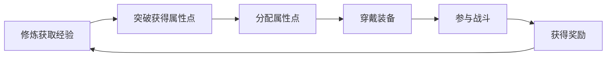
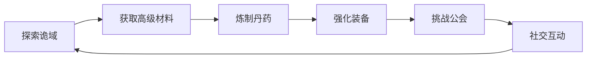
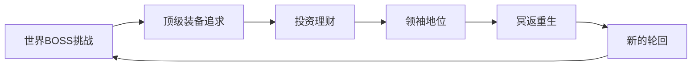

# 诡修仙游戏技术调研报告

## 文档信息
- **调研时间**: 2025-11-15
- **调研对象**: 诡修仙GuiXiuXian2项目
- **调研目标**: 项目架构分析、核心系统实现、数值设计、用户体验流程
- **版本**: v1.0

---

## 1. 项目架构分析

### 1.1 整体架构概述

诡修仙是一个基于Nonebot2框架的QQ群修仙游戏，采用分层架构设计，主要包含以下层次：

```
D:\QQbot\GuiXiuXian2\plugins\xiuxian_game\
├── 接入层 (Commands)     # Nonebot2命令处理
├── 业务逻辑层           # 各系统核心服务
├── 领域模型层           # 数据模型定义
└── 基础设施层           # 数据库、配置等
```

### 1.2 模块组织结构

#### 1.2.1 核心目录结构
```
xiuxian_game/
├── admin/              # 管理员系统
├── alchemy/            # 炼丹系统
├── battle/             # 战斗系统
├── cultivate/          # 修炼系统
├── daily_task/         # 每日任务系统
├── economy/            # 经济系统
├── entertainment/      # 娱乐系统
├── fishing/            # 钓鱼系统
├── guild/              # 公会系统
├── item/               # 物品装备系统
├── models/             # 数据模型
├── player/             # 玩家系统
├── social/             # 社交系统
├── world/              # 世界探索系统
└── world_boss/         # 世界BOSS系统
```

#### 1.2.2 技术栈
- **框架**: Nonebot2 (异步QQ机器人框架)
- **数据库**: SQLite (当前) / 规划MySQL
- **ORM**: SQLAlchemy 2.0 (异步ORM)
- **配置管理**: YAML配置文件
- **会话管理**: 自定义safe_session上下文管理器

### 1.3 架构特点与问题

#### 1.3.1 当前架构优势
- **模块化设计**: 按功能域清晰划分模块
- **异步支持**: 全面采用async/await模式
- **配置驱动**: 核心数值通过YAML配置管理
- **扩展性**: 支持插件式功能扩展

#### 1.3.2 架构问题 (基于REFACTORING_PLAN.md分析)
- **循环依赖**: `item_effects.py` ↔ `equipment_commands.py`
- **属性计算分散**: 4+处属性计算逻辑
- **会话管理混乱**: 3种会话模式并存
- **缺少依赖注入**: 全局导入导致紧耦合
- **效果系统重复**: 装饰器注册 vs 管理器模式

### 1.4 数据架构

#### 1.4.1 核心数据模型
主要实体关系:
```
Player (玩家)
├── ItemInstance (物品实例)
├── Equipment (装备)
├── GuildMember (公会成员)
├── TemporaryBuff (临时buff)
├── MarketOrder (市场订单)
└── AlchemyTask (炼丹任务)
```

#### 1.4.2 数据库设计特点
- **双层坐标系统**: 现实世界坐标 + 诡域内部坐标
- **状态管理**: 丰富的玩家状态字段
- **关联设计**: 一对多关系清晰，支持复杂查询

---

## 2. 核心系统实现分析

### 2.1 修炼系统 (cultimate/)

#### 2.1.1 系统架构
```python
# 核心文件: cultivate/core.py
├── 修炼逻辑 (cultivate)
├── 突破机制 (breakthrough)
├── 闭关系统 (seclusion)
└── 属性加点 (assign_points)
```

#### 2.1.2 关键机制
- **修炼冷却**: 300秒冷却时间
- **经验计算**: 基础经验 + 等级加成 + 阴宅加成
- **突破机制**:
  - 30级后可能失败
  - 失败保留70%修为
  - 支持怨念护航确保成功
- **闭关系统**:
  - 挂机升级，效率减半
  - 月卡可延长闭关时长
  - 阴宅提供额外效率加成

#### 2.1.3 代码特点
- **文案池**: 丰富的沉浸式文案增强游戏体验
- **状态检查**: 完善的前置条件验证
- **跨平台支持**: 统一的玩家获取逻辑

### 2.2 战斗系统 (battle/)

#### 2.2.1 增强战斗引擎
```python
# 核心文件: battle/enhanced_engine.py
class EnhancedBattleEngine:
    ├── 属性计算 (BattleAttributeCalculator)
    ├── 效果管理 (BattleEffectManager)
    ├── 触发系统 (TriggerType)
    └── 战斗日志
```

#### 2.2.2 战斗机制
- **属性体系**: 6基础属性 + 8战斗属性 + 4增强属性
- **效果系统**:
  - 触发类型: 被动/攻击时/防御时/回合开始/回合结束
  - 效果类型: 属性加成/状态改变/特殊效果
- **战斗流程**: 最多30回合，支持暴击、连击、反击、闪避
- **装备效果**: 装备可触发特殊战斗效果

#### 2.2.3 特色设计
- **双层战斗**: 玩家PVP + NPC战斗 + 世界BOSS
- **安全机制**: 城镇安全区 vs 荒野危险区
- **随机种子**: 支持确定性战斗重现

### 2.3 经济系统 (economy/)

#### 2.3.1 多元化经济体系
```python
economy/
├── market.py          # 交易市场
├── merchants.py       # 商人系统
├── bank.py           # 银行系统
├── stock_service.py  # 气运投资
└── part_time_job/    # 打工系统
```

#### 2.3.2 核心机制

**交易市场**:
- **双向交易**: 支持出售和求购
- **价格发现**: 基于历史成交价的智能定价
- **税收制度**: 阶梯式交易税 (0%-20%)
- **防刷钱**: 4小时内同地购买不可出售

**银行系统**:
- **存款机制**: 自动复利计算
- **利率策略**: 定期查询获得额外收益

**气运投资**:
- **价格波动**: 基于市场供需的价格引擎
- **交易成本**: 3%手续费
- **风险机制**: 投资有风险

**打工系统**:
- **快速收益**: 2-3分钟获得60-180金币
- **频率限制**: 每小时最多10次
- **事件奖励**: 运气值影响特殊事件

#### 2.3.3 经济平衡设计
- **基础货币**: 金币为主，积分辅助
- **多元获取**: 修炼、战斗、打工、投资、交易
- **消耗渠道**: 装备修理、丹药炼制、阴宅建造
- **财富指数**: 全服财富影响物价倍率

### 2.4 社交系统 (social/)

#### 2.4.1 多维度社交关系
```python
social/
├── marriage_service.py    # 婚姻系统
├── mentorship_service.py  # 师徒系统
├── gift_service.py        # 礼物系统
└── rankings.py            # 社交排行榜
```

#### 2.4.2 核心功能
- **婚姻系统**: 求婚→同意→结婚→离婚完整流程
- **师徒系统**: 拜师→收徒→出师传承机制
- **礼物系统**: 配偶/师父/徒弟间互送礼物
- **社交排行榜**: 恩爱榜、恩师榜等

#### 2.4.3 设计特点
- **关系约束**: 婚姻唯一性，师徒层级关系
- **情感数值**: 恩爱值、恩师点等情感指标
- **社交奖励**: 社交行为获得额外收益

### 2.5 公会系统 (guild/)

#### 2.5.1 组织架构
```python
guild/
├── guild.py              # 公会核心
├── guild_service.py      # 公会服务
├── guild_building_service.py  # 建筑系统
├── guild_task_service.py      # 任务系统
└── guild_economy_service.py  # 公会经济
```

#### 2.5.2 核心机制
- **组织管理**: 创建→加入→退会→解散完整流程
- **职位体系**: 会长>副会长>核心成员>普通成员
- **建筑系统**:
  - 多种建筑类型提供不同加成
  - 建造升级消耗公会资源
- **任务系统**: 每日公会任务，集体奖励
- **经济系统**: 公会捐献、积分兑换

#### 2.5.3 特色设计
- **势力范围**: 公会可控制地理区域
- **传送功能**: 公会成员快速移动
- **协作玩法**: 增强玩家间协作需求

### 2.6 炼丹系统 (alchemy/)

#### 2.6.1 炼丹机制
```python
alchemy/
└── service.py
    ├── 配方管理 (get_recipes)
    ├── 成功率计算 (get_furnace_effects)
    ├── 材料消耗 (materials)
    └── 产物生成 (quantity)
```

#### 2.6.2 核心特点
- **配方系统**: 分级丹药配方(初级→高级)
- **材料消耗**: 基于配方精确计算
- **成功率**: 炼丹炉等级影响成功率
- **每日限制**: 丹药服用次数限制

#### 2.6.3 丹药类型
- **经验丹**: 效果随等级提升
- **治疗丹**: 百分比恢复
- **战斗丹**: 临时增益
- **永久丹**: 固定值永久提升
- **洗髓丹**: 属性转换功能

---

## 3. 数值设计文档分析

### 3.1 基础配置 (config.yaml)

#### 3.1.1 成长体系
```yaml
game:
  max_level: 300                    # 最大等级
  base_exp: 10                     # 基础经验值
  points_per_level: 10              # 每级属性点
  exp_curve:
    early_multiplier: 10            # 前期经验倍率
    late_multiplier: 6              # 后期经验倍率
    curve_change_level: 10          # 倍率变化等级点
```

#### 3.1.2 冥返机制
```yaml
reincarnation:
  cultivation_efficiency_bonus: 0.5  # 每转修炼效率+50%
  seclusion_efficiency_bonus: 0.5     # 每转闭关效率+50%
```

#### 3.1.3 资源掉落
```yaml
resource_control:
  base_drop_rates:
    white: 0.30    # 白色材料30%
    green: 0.15    # 绿色材料15%
    blue: 0.08     # 蓝色材料8%
    purple: 0.03   # 紫色材料3%
    orange: 0.01   # 橙色材料1%
```

### 3.2 修炼系统数值

#### 3.2.1 修炼配置
```yaml
cultivate:
  cool_down: 300           # 5分钟冷却
  base_exp: 50            # 基础经验
  breakthrough:
    change_level: 30       # 30级后可能失败
    fail_keep_ratio: 0.7  # 失败保留70%修为
    guardian_cost: 50      # 护航消耗怨念
    base_success_rate: 0.8 # 基础成功率80%
    min_success_rate: 0.1  # 最低成功率10%
```

#### 3.2.2 属性成长
```yaml
attributes_base:
  max_hp: 3    # 体魄: +3HP/级
  max_mp: 1    # 灵智: +1MP/级
  attack: 1    # 力量: +1攻击/级
  defense: 1   # 防御: +1防御/级
  agility: 1   # 敏捷: +1敏捷/级
  luck: 1      # 运气: +1运气/级
```

### 3.3 月卡系统数值

#### 3.3.1 基础月卡 (8.8元)
```yaml
monthly_card.basic:
  cultivation_efficiency: 0.2      # 修炼效率+20%
  seclusion_time_limit: 9         # 闭关上限9小时
  seclusion_efficiency: 0.2        # 闭关效率+20%
  inventory_bonus: 5               # 背包+5格
  breakthrough_protection: 0.75    # 失败保留75%修为
```

#### 3.3.2 高级月卡 (28.8元)
```yaml
monthly_card.premium:
  cultivation_efficiency: 0.5      # 修炼效率+50%
  seclusion_time_limit: 12         # 闭关上限12小时
  seclusion_efficiency: 0.5        # 闭关效率+50%
  inventory_bonus: 20              # 背包+20格
  auto_collect: true               # 自动采集材料
  breakthrough_protection: 0.8     # 失败保留80%修为
```

### 3.4 战斗系统数值

#### 3.4.1 基础属性 (Player模型)
```python
# 战斗相关属性
critical_rate: 5        # 暴击率5%
critical_power: 0        # 暴击力0
combo_rate: 0            # 连击率0%
counter_rate: 0          # 反击率0%
dodge_rate: 0            # 闪避率0%
accuracy_rate: 80        # 命中率80%
```

#### 3.4.2 增强战斗属性
```python
lifesteal_rate: 0        # 吸血率0%
immobilize_rate: 0       # 定身率0%
true_damage_rate: 0      # 真伤率0%
regen_rate: 0            # 回血率0%
```

### 3.5 经济系统数值

#### 3.5.1 交易税率
```python
# 阶梯税率:
# ≤5000: 免税
# 5001-20000: 5%
# 20001-50000: 10%
# 50001-100000: 15%
# >100000: 20%
```

#### 3.5.2 价格倍率
```python
ECONOMY_MULT_BY_TYPE = {
    "MATERIAL": 0.7,     # 材料0.7倍
    "GOODS": 0.9,        # 商品0.9倍
    "CONSUMABLE": 1.2,   # 消耗品1.2倍
    "GEM": 2.0,          # 宝石2.0倍
    "EQUIPMENT": 4.0,    # 装备4.0倍
    "FISH": 0.9,         # 鱼类0.9倍
}

ECONOMY_MULT_BY_RARITY = {
    "white": 1.0,       # 白色1.0倍
    "green": 1.05,      # 绿色1.05倍
    "blue": 1.10,       # 蓝色1.10倍
    "purple": 1.20,     # 紫色1.20倍
    "orange": 1.30,     # 橙色1.30倍
}
```

---

## 4. 用户体验流程分析

### 4.1 新手引导流程

#### 4.1.1 角色创建阶段
```
注册 → 起始定位(大都会0,0) → 初始属性分配 → 获得新手装备 → 加入新手群
```

#### 4.1.2 基础玩法学习
1. **修炼系统**: 理解经验获取和等级提升
2. **背包系统**: 学会使用物品和装备
3. **移动探索**: 掌握坐标移动和地点探索
4. **基础战斗**: 了解PVP和NPC战斗机制

#### 4.1.3 新手保护
- **免费洗点**: 30级以下可重置属性点
- **初始装备**: 提供基础装备避免开局困难
- **引导群**: 新手群提供及时帮助

### 4.2 成长路径规划

#### 4.2.1 前期成长 (1-30级)


**核心活动**:
- 修炼升级为主
- 收集基础材料
- 参与新手战斗
- 了解基础经济系统

#### 4.2.2 中期成长 (31-100级)


**核心活动**:
- 诡域深度探索
- 丹药炼制和服用
- 装备锻造和升阶
- 公会建设和任务
- 婚姻师徒等社交

#### 4.2.3 后期成长 (101-300级)


**核心活动**:
- 世界BOSS团队战
- 高端装备收藏
- 气运投资理财
- 公会领袖管理
- 冥返转生重开

### 4.3 日常活动循环

#### 4.3.1 每日必做
```python
每日循环:
    签到 → 修炼/闭关 → 日常任务 → 打工赚钱 →
    市场交易 → 炼丹 → 装备维护 → 社交互动
```

#### 4.3.2 每周活动
- **公会任务**: 每周刷新的公会挑战
- **世界BOSS**: 定期的世界BOSS挑战
- **市场博弈**: 价格波动投资机会
- **特殊事件**: 周主题活动和限时活动

#### 4.3.3 长期目标
- **等级追求**: 冲刺300级满级
- **装备收集**: 收集稀有和传说装备
- **财富积累**: 成为服务器首富
- **社交地位**: 建立广泛的人脉网络
- **冥返重生**: 完成轮回获得新机遇

### 4.4 社交互动节点

#### 4.4.1 强社交场景
- **公会系统**: 协作建设，共同成长
- **婚姻系统**: 深度绑定，利益共享
- **师徒系统**: 传承教学，互助成长
- **团队合作**: BOSS战、副本等协作内容

#### 4.4.2 轻社交场景
- **市场交易**: 买卖互动，价格博弈
- **礼物赠送**: 表达情感，增进关系
- **留言板**: 信息分享，社区建设
- **排行榜**: 竞争激励，目标设定

---

## 5. 技术债务与局限性

### 5.1 架构层面问题

#### 5.1.1 循环依赖问题
**问题位置**: `item_effects.py` ↔ `equipment_commands.py`
```python
# item_effects.py (line 13)
from .equipment_commands import recalc_equipment_attributes  # ❌ 循环依赖

# equipment_commands.py (line 100+)
from ..item.item_effects import apply_equipment_effect        # ❌ 循环依赖
```

**影响**:
- 模块间紧耦合，难以独立测试
- 代码维护困难，修改影响面大
- 新增功能扩展性差

#### 5.1.2 属性计算分散
**分散位置**:
- `models/player.py:218-256` - get_effective_attributes
- `battle/battle_attributes.py` - BattleAttributeCalculator
- `item/item_effects.py` - 装备效果计算
- `models/temporary_buff.py` - Buff加成计算

**影响**:
- 属性计算逻辑不统一
- 调试困难，难以追踪属性来源
- 容易出现计算错误

#### 5.1.3 会话管理混乱
**三种会话模式并存**:
1. 全局safe_session
2. 直接AsyncSession创建
3. UoW模式(部分模块)

**影响**:
- 事务边界不清晰
- 容易出现并发问题
- 代码风格不统一

### 5.2 性能瓶颈

#### 5.2.1 SQLite性能限制
- **并发处理**: SQLite并发写入性能较差
- **查询效率**: 复杂查询性能下降
- **扩展性**: 难以支持大规模用户

#### 5.2.2 缺少缓存层
- **重复查询**: 玩家数据频繁重复查询
- **计算开销**: 属性计算缺乏缓存
- **响应延迟**: 高并发时响应变慢

#### 5.2.3 查询优化不足
- **N+1查询**: 部分查询存在N+1问题
- **索引缺失**: 关键查询缺少合适索引
- **批量操作**: 缺少批量优化处理

### 5.3 代码质量问题

#### 5.3.1 硬编码依赖
```python
# 全局导入导致紧耦合
from ..models.db import safe_session  # ❌ 硬编码依赖
from ..config import config           # ❌ 硬编码依赖
```

#### 5.3.2 缺少抽象接口
- 服务类没有Protocol/ABC约束
- 依赖具体实现而非抽象接口
- 难以进行mock测试

#### 5.3.3 错误处理不统一
- 异常类型使用不规范
- 错误信息不够详细
- 缺少统一的错误处理机制

### 5.4 可维护性问题

#### 5.4.1 配置管理分散
- 配置散布在多个YAML文件
- 部分配置仍写在代码中
- 缺少配置验证机制

#### 5.4.2 日志记录不完善
- 关键操作缺少日志
- 错误日志不够详细
- 缺少性能监控日志

#### 5.4.3 测试覆盖不足
- 核心逻辑缺少单元测试
- 集成测试覆盖不完整
- 缺少自动化测试流程

---

## 6. 关键成功因素

### 6.1 游戏设计优势

#### 6.1.1 丰富的玩法体系
- **多维度成长**: 修炼、战斗、社交、经济四维成长
- **深度内容**: 300级长线成长，冥返轮回机制
- **社交粘性**: 婚姻、师徒、公会等多重社交绑定

#### 6.1.2 平衡的经济系统
- **多元获取**: 多种资源获取渠道
- **合理消耗**: 装备、丹药、阴宅等消耗项目
- **市场机制**: 供需关系驱动的动态定价

#### 6.1.3 沉浸式体验
- **主题文案**: 诡修仙风格的沉浸式文案
- **世界观设定**: 完整的修仙世界观
- **互动体验**: NPC交互、世界探索等丰富互动

### 6.2 技术实现亮点

#### 6.2.1 异步架构优势
- **高性能**: 全面异步支持，高并发处理能力强
- **响应及时**: 快速响应用户操作
- **资源利用**: 更好的系统资源利用率

#### 6.2.2 配置驱动设计
- **灵活调整**: 核心数值可通过配置调整
- **热更新**: 部分配置支持热更新
- **版本管理**: 配置版本化管理

#### 6.2.3 模块化扩展
- **功能解耦**: 各系统相对独立，便于扩展
- **插件机制**: 支持功能插件化扩展
- **版本兼容**: 向后兼容的版本管理

### 6.3 社区运营要素

#### 6.3.1 跨平台支持
- **多端互通**: QQ群和频道数据互通
- **统一体验**: 跨平台一致的用户体验
- **账号绑定**: 安全的账号绑定机制

#### 6.3.2 运营工具完善
- **管理功能**: 完善的后台管理工具
- **数据统计**: 详细的玩家行为分析
- **活动系统**: 灵活的活动举办机制

#### 6.3.3 付费设计合理
- **月卡体系**: 分层的付费权益设计
- **价值感知**: 清晰的付费价值回报
- **公平性**: 付费不影响游戏平衡

---

## 7. 总结与建议

### 7.1 项目价值评估

#### 7.1.1 整体评分
- **游戏设计**: ⭐⭐⭐⭐⭐ (5/5) - 丰富的玩法和深度内容
- **技术架构**: ⭐⭐⭐☆☆ (3/5) - 基础扎实但有技术债务
- **用户体验**: ⭐⭐⭐⭐☆ (4/5) - 流程完善但有优化空间
- **可维护性**: ⭐⭐☆☆☆ (2/5) - 存在较多技术债务
- **扩展潜力**: ⭐⭐⭐⭐☆ (4/5) - 架构基础支持扩展

#### 7.1.2 核心优势
1. **玩法丰富度**: 国内QQ群修仙游戏的标杆作品
2. **技术先进性**: 异步架构和配置驱动设计
3. **社区活跃度**: 完善的社交体系和运营机制
4. **商业价值**: 合理的付费设计和用户粘性

#### 7.1.3 主要挑战
1. **技术债务**: 循环依赖、性能瓶颈需要系统性解决
2. **架构重构**: 需要向更松耦合的架构演进
3. **性能优化**: 需要引入缓存和数据库优化
4. **测试覆盖**: 需要建立完善的测试体系

### 7.2 技术优化建议

#### 7.2.1 近期优化 (1-2个月)
1. **解决循环依赖**: 重构item_effects和equipment_commands
2. **统一属性计算**: 实现统一的属性计算器
3. **引入缓存层**: 添加Redis缓存玩家数据
4. **数据库迁移**: 从SQLite迁移到MySQL

#### 7.2.2 中期改进 (3-6个月)
1. **依赖注入**: 实现DI容器解耦模块依赖
2. **事件系统**: 引入领域事件解耦副作用
3. **监控体系**: 建立完善的监控和告警
4. **测试体系**: 建立单元测试和集成测试

#### 7.2.3 长期规划 (6-12个月)
1. **微服务化**: 按领域拆分为微服务
2. **容器化**: Docker容器化部署
3. **多实例**: 支持多实例负载均衡
4. **API化**: 提供开放API支持第三方扩展

### 7.3 产品发展建议

#### 7.3.1 内容扩展
1. **新玩法**: 定期推出新的游戏玩法和活动
2. **剧情深化**: 增加NPC互动和剧情内容
3. **社交增强**: 丰富社交功能和互动玩法
4. **赛季系统**: 引入赛季制增加游戏新鲜感

#### 7.3.2 技术创新
1. **AI NPC**: 引入AI技术提升NPC交互体验
2. **图形化**: 逐步增加图形化界面元素
3. **移动端**: 考虑开发移动端应用
4. **数据分析**: 基于大数据优化游戏体验

#### 7.3.3 运营优化
1. **用户分层**: 针对不同用户群体精准运营
2. **活动策划**: 定期举办特色运营活动
3. **社区建设**: 加强社区建设和用户维护
4. **商业优化**: 优化付费设计和收入模式

### 7.4 结论

诡修仙是一款设计优秀、技术实现相对完整的高质量QQ群修仙游戏。项目在游戏设计、玩法创新、社交粘性等方面表现出色，但在架构设计、代码质量、性能优化等方面存在一定技术债务。

**核心建议**:
1. **优先解决技术债务**: 通过系统重构解决循环依赖和性能问题
2. **保持游戏优势**: 继续深化游戏内容和社交体验
3. **拥抱新技术**: 引入AI、缓存、监控等新技术提升用户体验
4. **长期发展规划**: 制定清晰的3-5年技术发展规划

通过技术重构和持续优化，诡修仙有潜力成为国内QQ群修仙游戏的标杆产品，并在更广阔的游戏市场中获得成功。