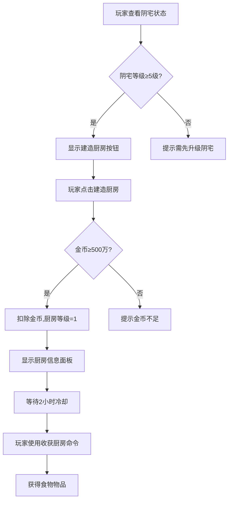
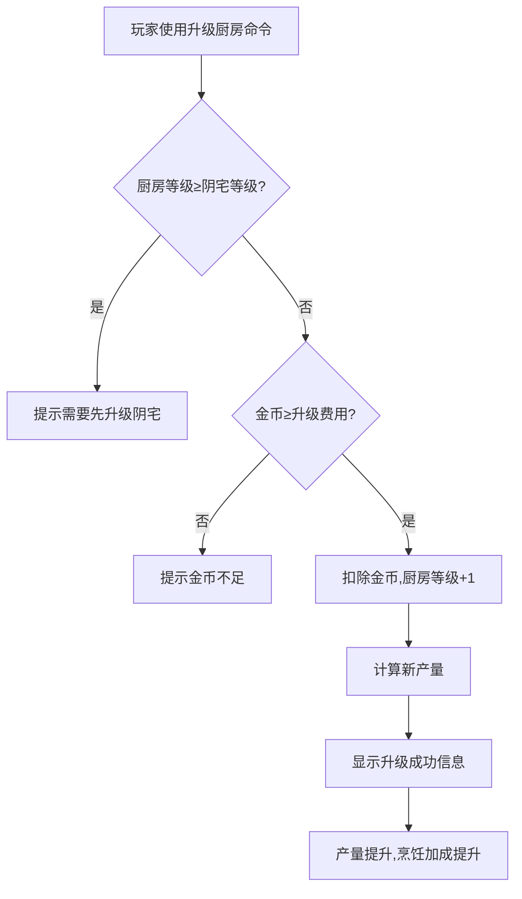
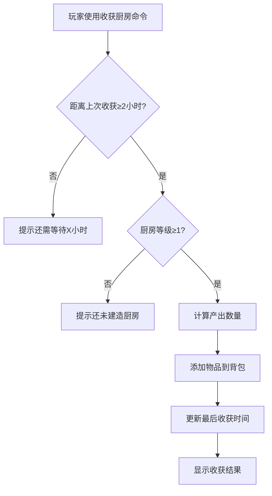

# 阴宅系统增强设计

## 1. Identity

- **What it is**: 阴宅系统增强方案,在现有修炼效率加成基础上,新增厨房、鱼塘等功能模块,提供被动收益和资源产出
- **Purpose**: 丰富阴宅玩法,提供多样化经济收益,增强长期留存和目标感

## 2. Core Components

### 现有阴宅系统 (已完成)

- `plugins/xiuxian_game/models/player.py:191-196` (mansion_level, mansion_x, mansion_y, mansion_usage_fee, mansion_allow_others, mansion_willing_to_pay): Player表扩展字段,支持阴宅基础功能
- `plugins/xiuxian_game/cultivate/mansion_service_new.py:12-25` (MansionService): DI架构版阴宅服务,提供升级费用计算、效率加成、权限管理
- `plugins/xiuxian_game/cultivate/mansion_commands.py:15-21` (mansion相关命令处理器): 购买、升级、设置费用、切换权限、迁移等命令

### 新增功能模块 (设计阶段)

- `plugins/xiuxian_game/models/player.py` (kitchen_level, fish_pond_level, garden_level等): 新增功能等级字段
- `plugins/xiuxian_game/cultivate/mansion_facilities_service.py` (MansionFacilitiesService): 设施管理服务
- `plugins/xiuxian_game/cultivate/mansion_facilities_commands.py` (facility相关命令): 厨房、鱼塘、花园等设施命令
- `plugins/xiuxian_game/schedulers/mansion_facility_scheduler.py` (定时任务): 被动收益定时结算

## 3. Execution Flow (LLM Retrieval Map)

### 当前阴宅升级流程

**1. 购买阴宅**: 【购买阴宅】命令 → `mansion_commands.py:40` → `MansionService.purchase_mansion()` (`mansion_service_new.py:570-636`)
**2. 位置验证**: 检查是否在原点、距离城镇市集限制、是否已有阴宅 (`mansion_service_new.py:594-604`)
**3. 扣除金币**: `player.gold -= purchase_cost` (1000万金币起) (`mansion_service_new.py:610`)
**4. 设置等级**: `player.mansion_level = 1` (`mansion_service_new.py:608`)
**5. 效率加成**: 1级=20%, 30级=281% (每级+9%) (`mansion_service_new.py:74-90`)

### 增强后设施解锁流程 (设计)

**1. 等级检查**: 阴宅达到指定等级自动解锁设施
- 5级解锁厨房 (烹饪加成)
- 10级解锁鱼塘 (鱼类产出)
- 15级解锁花园 (草药产出)
- 20级解锁工坊 (装备耐久修复)
- 25级解锁仓库 (额外储物空间)

**2. 设施升级**: 【升级厨房】命令 → `MansionFacilitiesService.upgrade_facility()` → 检查阴宅等级前置、扣除材料/金币 → 提升设施等级

**3. 被动收益**: 定时任务每小时触发 → `MansionFacilityScheduler.collect_passive_income()` → 计算产量 → 自动添加到玩家背包

## 4. Design Rationale

### 为什么选择厨房、鱼塘等功能?

**1. 多样化收益来源**:
- 现有阴宅仅提供修炼效率加成 (单一维度)
- 新增设施提供材料、食物、装备修复等 (多维度经济收益)

**2. 渐进式解锁**:
- 避免一次性开放所有功能造成认知负荷
- 通过阴宅等级引导玩家逐步体验新玩法

**3. 长期目标感**:
- 30级阴宅升级曲线陡峭 (1.5^n指数增长)
- 设施升级提供中期目标 (5级解锁厨房, 10级解锁鱼塘...)

**4. 经济系统平衡**:
- 厨房产出恢复类食物 (减少药品购买需求)
- 鱼塘产出鱼类材料 (烹饪原材料+恢复物品)
- 花园产出草药 (减少市场购买材料依赖)

### 为什么使用被动收益模式?

**1. 符合QQ Bot特性**:
- 高频交互不适合 (每5分钟修炼已接近极限)
- 被动收益每小时结算 (低频,不刷屏)

**2. 增强留存**:
- 玩家上线有"收获感" (类似农场游戏)
- 鼓励玩家定期查看阴宅状态

**3. 避免自动化**:
- 不支持"挂机脚本" (收益需要手动收取,否则有上限)
- 保持玩家活跃度

### 为什么限制设施等级上限?

**1. 平衡性考虑**:
- 设施等级不可超过阴宅等级 (避免过度依赖低级阴宅刷高级设施)
- 例如: 10级阴宅最多只能建10级鱼塘

**2. 升级动力**:
- 玩家必须升级阴宅才能继续升级设施
- 维持阴宅升级的核心地位

**3. 经济膨胀控制**:
- 被动收益有上限 (防止无限刷材料)
- 材料产出量与设施等级挂钩,但收益递减

---

## 5. 数据模型设计

### 5.1 Player表字段扩展

**位置**: `plugins/xiuxian_game/models/player.py`

```python
# 现有阴宅字段
mansion_level: Mapped[int] = mapped_column(Integer, default=0, server_default='0', comment="阴宅等级(0表示未拥有)")
mansion_x: Mapped[int | None] = mapped_column(Integer, nullable=True, comment="阴宅X坐标")
mansion_y: Mapped[int | None] = mapped_column(Integer, nullable=True, comment="阴宅Y坐标")
mansion_usage_fee: Mapped[int] = mapped_column(Integer, default=0, server_default='0', comment="阴宅使用费用")
mansion_allow_others: Mapped[bool] = mapped_column(Boolean, default=True, server_default=text('1'))
mansion_willing_to_pay: Mapped[bool] = mapped_column(Boolean, default=True, server_default=text('1'))

# 新增设施字段 (设计阶段)
kitchen_level: Mapped[int] = mapped_column(Integer, default=0, server_default='0', comment="厨房等级(0表示未建造)")
fish_pond_level: Mapped[int] = mapped_column(Integer, default=0, server_default='0', comment="鱼塘等级")
garden_level: Mapped[int] = mapped_column(Integer, default=0, server_default='0', comment="花园等级")
workshop_level: Mapped[int] = mapped_column(Integer, default=0, server_default='0', comment="工坊等级")
warehouse_level: Mapped[int] = mapped_column(Integer, default=0, server_default='0', comment="仓库等级")

# 设施最后收获时间 (防止过度挂机)
kitchen_last_harvest: Mapped[datetime | None] = mapped_column(DateTime, nullable=True, comment="厨房最后收获时间")
fish_pond_last_harvest: Mapped[datetime | None] = mapped_column(DateTime, nullable=True, comment="鱼塘最后收获时间")
garden_last_harvest: Mapped[datetime | None] = mapped_column(DateTime, nullable=True, comment="花园最后收获时间")
```

### 5.2 设施配置YAML

**位置**: `plugins/xiuxian_game/data/mansion_facilities.yaml`

```yaml
facilities:
  kitchen:
    name: "厨房"
    description: "生产恢复类食物和烹饪加成"
    unlock_mansion_level: 5
    max_level: 30
    upgrade_cost_formula: "5000000 * (1.5 ** (level - 1))"  # 500万起,指数增长
    production:
      cooldown_hours: 2  # 每2小时可收获一次
      base_output:
        - item_id: "cooked_fish"
          base_quantity: 5
          quantity_increment: 2  # 每级+2个
        - item_id: "spirit_meal"
          base_quantity: 3
          quantity_increment: 1
      passive_bonus:
        cooking_speed_bonus: 0.05  # 每级+5%烹饪速度

  fish_pond:
    name: "鱼塘"
    description: "产出鱼类和恢复MP的鱼汤"
    unlock_mansion_level: 10
    max_level: 30
    upgrade_cost_formula: "8000000 * (1.5 ** (level - 1))"  # 800万起
    production:
      cooldown_hours: 3
      base_output:
        - item_id: "raw_fish"
          base_quantity: 8
          quantity_increment: 3
        - item_id: "fish_soup"
          base_quantity: 2
          quantity_increment: 1

  garden:
    name: "花园"
    description: "产出草药和炼丹材料"
    unlock_mansion_level: 15
    max_level: 30
    upgrade_cost_formula: "10000000 * (1.5 ** (level - 1))"  # 1000万起
    production:
      cooldown_hours: 4
      base_output:
        - item_id: "herb_common"
          base_quantity: 10
          quantity_increment: 4
        - item_id: "herb_rare"
          base_quantity: 1
          quantity_increment: 1
      alchemy_bonus:
        pill_success_rate: 0.02  # 每级+2%丹药成功率
```

## 6. 功能详细设计

### 6.1 厨房系统

**解锁条件**: 阴宅达到5级

**核心功能**:
1. **被动产出**: 每2小时生产恢复类食物 (熟鱼、灵食等)
2. **烹饪加成**: 提升烹饪速度 (每级+5%)
3. **手动收获**: 【收获厨房】命令收取产物

**产出示例**:
```
1级厨房 (每2小时):
- 熟鱼 x5 (恢复50 HP)
- 灵食 x3 (恢复80 HP)

10级厨房 (每2小时):
- 熟鱼 x23 (5 + 2*(10-1))
- 灵食 x12 (3 + 1*(10-1))
- 烹饪速度+50%
```

**交互流程**:
1. 玩家阴宅≥5级 → 自动显示【建造厨房】命令
2. 使用【建造厨房】 → 扣除500万金币 → kitchen_level=1
3. 等待2小时冷却 → 使用【收获厨房】 → 获得食物
4. 使用【升级厨房】 → 扣除升级费用 → 提升产量

### 6.2 鱼塘系统

**解锁条件**: 阴宅达到10级

**核心功能**:
1. **被动产出**: 每3小时生产鱼类 (生鱼、鱼汤)
2. **MP恢复**: 鱼汤可恢复MP (替代凝神草)
3. **生态系统**: 鱼塘等级越高,鱼类品种越多

**产出示例**:
```
5级鱼塘 (每3小时):
- 生鱼 x20 (可烹饪或直接出售)
- 鱼汤 x6 (恢复40 MP)

20级鱼塘 (每3小时):
- 生鱼 x65
- 鱼汤 x22
- 特殊: 灵鱼 x2 (恢复100 MP,仅20级+产出)
```

**经济平衡**:
- 生鱼可出售 (市场价值200金币/条)
- 鱼汤替代凝神草 (原价500金币,自产降低成本)
- 避免药品漏洞 (鱼汤有使用上限,每日最多10次)

### 6.3 花园系统

**解锁条件**: 阴宅达到15级

**核心功能**:
1. **草药产出**: 每4小时生产普通草药和稀有草药
2. **炼丹加成**: 提升丹药成功率 (每级+2%)
3. **品种扩展**: 高级花园产出稀有材料 (灵芝、人参等)

**产出示例**:
```
10级花园 (每4小时):
- 普通草药 x46
- 稀有草药 x10
- 炼丹成功率+20%

25级花园 (每4小时):
- 普通草药 x106
- 稀有草药 x25
- 传说草药 x3 (灵芝、天仙子)
- 炼丹成功率+50%
```

### 6.4 工坊系统 (设计阶段)

**解锁条件**: 阴宅达到20级

**核心功能**:
1. **装备修复**: 每日自动修复装备耐久 (每级恢复100点耐久)
2. **强化加成**: 提升装备升阶成功率 (每级+3%)
3. **宝石镶嵌**: 免费镶嵌宝石 (无需消耗金币)

### 6.5 仓库系统 (设计阶段)

**解锁条件**: 阴宅达到25级

**核心功能**:
1. **额外储物**: 增加背包上限 (每级+10格)
2. **自动分类**: 自动整理物品 (按类型分组)
3. **贵重保管**: 防止死亡掉落 (仓库内物品不丢失)

## 7. 交互流程设计

### 7.1 建造设施流程



### 7.2 升级设施流程



### 7.3 收获流程



## 8. 经济平衡分析

### 8.1 升级成本对比

| 设施类型 | 解锁阴宅等级 | 建造费用 (1级) | 10级总费用 | 20级总费用 |
|---------|------------|--------------|-----------|-----------|
| **阴宅本体** | 1级 | 1,000万 | 25.7亿 | 8.3万亿 |
| **厨房** | 5级 | 500万 | 12.8亿 | 4.2万亿 |
| **鱼塘** | 10级 | 800万 | 20.5亿 | 6.6万亿 |
| **花园** | 15级 | 1,000万 | 25.7亿 | 8.3万亿 |

**设计原则**:
- 设施升级成本约为阴宅升级成本的50%
- 确保玩家优先升级阴宅 (不分散核心目标)

### 8.2 收益分析

**厨房收益** (10级为例):
- 每2小时产出: 熟鱼x23 + 灵食x12
- 每日产量: 12次 = 熟鱼276 + 灵食144
- 市场价值: 熟鱼200金币, 灵食500金币
- 每日收益: 276*200 + 144*500 = 55,200 + 72,000 = 127,200金币
- **投资回报期**: 10级厨房总费用12.8亿 / 12.7万/天 ≈ 10,078天 ≈ 27年

**结论**: 被动收益不是主要目的,而是**便利性** (减少购买药品/食物需求)

### 8.3 防刷机制

1. **冷却时间**: 厨房2小时, 鱼塘3小时, 花园4小时
2. **收获上限**: 单次收获最多24小时产量 (防止长期挂机)
3. **使用上限**: 鱼汤每日最多使用10次 (避免替代药品刷经验)
4. **等级限制**: 设施等级不可超过阴宅等级

## 9. 实现路线图

### Phase 1: 数据模型扩展 (1周)

**任务清单**:
- [ ] 扩展Player表,添加6个设施等级字段
- [ ] 添加3个last_harvest时间字段
- [ ] 创建数据库迁移脚本 (`auto_migrate.py`自动检测)
- [ ] 编写设施配置YAML (`mansion_facilities.yaml`)

**预期工作量**: 2人日
**风险**: 低 (仅扩展字段,不影响现有功能)

### Phase 2: 核心服务实现 (2周)

**任务清单**:
- [ ] 实现`MansionFacilitiesService` (DI架构)
  - `build_facility()` - 建造设施
  - `upgrade_facility()` - 升级设施
  - `harvest_facility()` - 收获产物
  - `calculate_output()` - 计算产量
- [ ] 实现`MansionFacilityScheduler` (定时任务)
  - 每小时检查可收获状态
  - 防止过度挂机 (24小时上限)
- [ ] 扩展`MansionService` (兼容新功能)
  - 修改`format_mansion_status()`显示设施信息
  - 添加设施解锁检查

**预期工作量**: 5人日
**风险**: 中 (需与现有阴宅系统集成)

### Phase 3: 命令处理器实现 (1周)

**任务清单**:
- [ ] 实现设施管理命令
  - 【建造厨房】、【升级厨房】、【收获厨房】
  - 【建造鱼塘】、【升级鱼塘】、【收获鱼塘】
  - 【建造花园】、【升级花园】、【收获花园】
- [ ] 实现设施状态查看命令
  - 【查看厨房】、【查看鱼塘】、【查看花园】
  - 【设施列表】(显示所有设施状态)
- [ ] 更新【阴宅】命令,显示设施信息

**预期工作量**: 3人日
**风险**: 低 (独立命令,不影响现有流程)

### Phase 4: 物品和平衡调整 (1周)

**任务清单**:
- [ ] 添加新物品到`items.yaml`
  - 熟鱼、灵食、鱼汤、草药...
- [ ] 调整现有物品价格 (避免冲突)
  - 凝神草保持500金币 (鱼汤不替代)
- [ ] 测试经济平衡
  - 验证收益不会导致通货膨胀
  - 验证防刷机制有效

**预期工作量**: 3人日
**风险**: 中 (需经济系统调研数据支撑)

### Phase 5: UI和文档优化 (3天)

**任务清单**:
- [ ] 优化设施信息显示 (进度条、倒计时)
- [ ] 更新帮助文档 (`help.py`)
- [ ] 编写玩家指南 (设施玩法说明)
- [ ] 发布公告 (新功能上线)

**预期工作量**: 1.5人日
**风险**: 低

## 10. 风险评估

### 10.1 经济风险

| 风险类型 | 严重程度 | 缓解措施 |
|---------|---------|---------|
| **材料通胀** | 🟠 中高 | 设置产量上限,冷却时间 |
| **药品替代** | 🟠 中 | 鱼汤每日使用上限10次 |
| **金币产出过多** | 🟡 中 | 设施建造费用高,回报期长 |

### 10.2 技术风险

| 风险类型 | 严重程度 | 缓解措施 |
|---------|---------|---------|
| **数据库迁移失败** | 🟡 中 | 使用`auto_migrate.py`,自动回滚 |
| **定时任务性能问题** | 🟢 低 | 每小时执行,批量处理 |
| **背包空间不足** | 🟡 中 | 收获失败提示,扩建仓库 |

### 10.3 玩家反馈风险

| 风险类型 | 严重程度 | 缓解措施 |
|---------|---------|---------|
| **功能过于复杂** | 🟠 中 | 渐进式解锁,分阶段引导 |
| **收益不如预期** | 🟡 中 | 强调便利性,不是主要收益来源 |
| **老玩家平衡性** | 🟡 中 | 老玩家阴宅等级高,可直接解锁高级设施 |

### 10.4 回滚方案

**紧急回滚** (1小时内):
1. 禁用所有设施命令 (Feature Flag)
2. 停止定时任务
3. 数据保留 (设施字段不影响现有功能)

**数据清理** (必要时):
1. 删除新增的Player字段 (需手动执行SQL)
2. 回滚数据库迁移
3. 恢复备份

## 11. 相关文档

- **现有阴宅系统**: `/architecture/current-architecture.md` (Section 阴宅系统)
- **数据模型**: `/reference/data-models.md` (Player模型)
- **经济系统**: `/design/investment_anti_arbitrage_redesign.md` (反套利机制参考)
- **新手体验优化**: `/design/game_system_redesign_2025_12_02.md` (渐进式解锁设计)

---

**设计者**: recorder 代理
**审核者**: (待人类开发者审核)
**状态**: 设计阶段
**预期完成**: 2026-01-15 (约3周开发周期)
