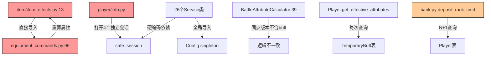
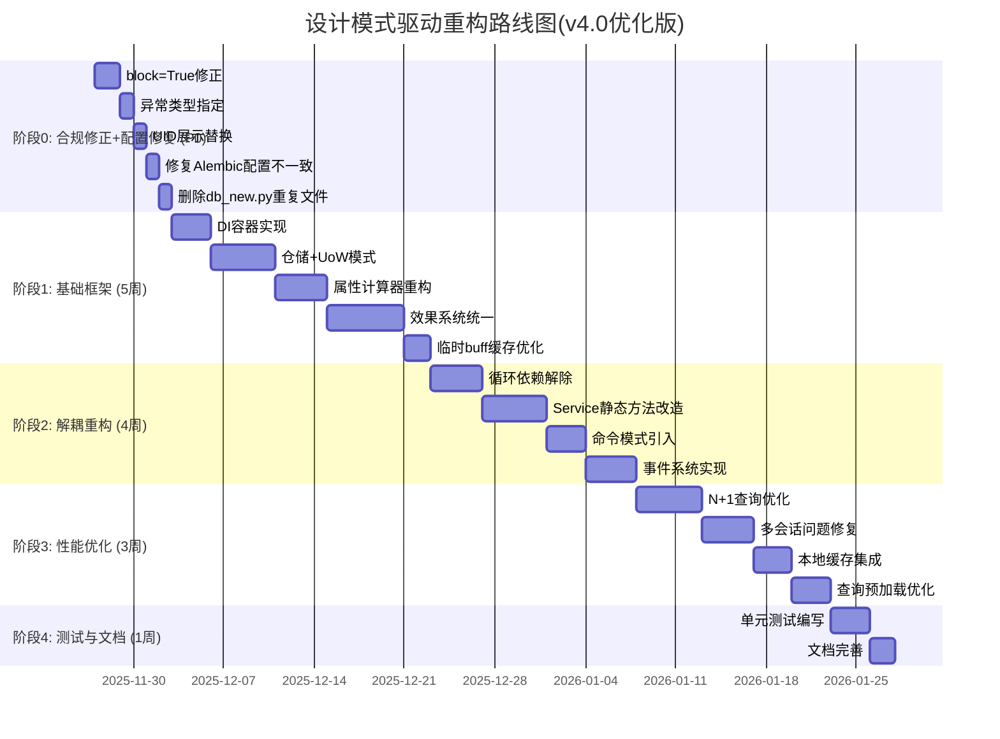
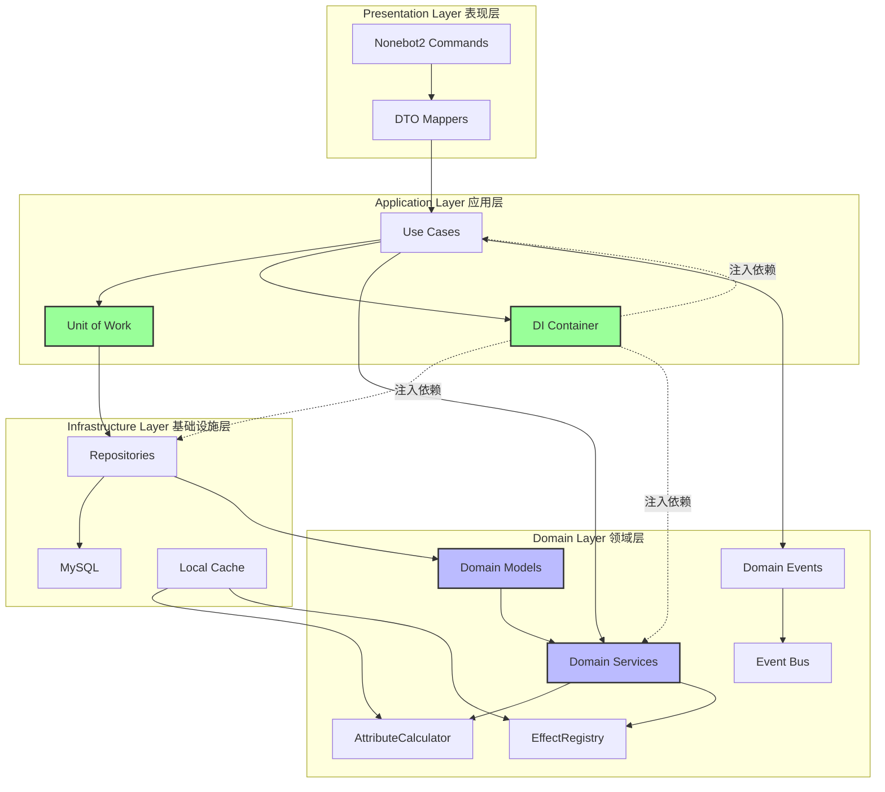

# 诡修仙游戏重构规划文档 v4.0 - 基于深度代码调研的优化版

> **项目名称**: 诡修仙 (GuiXiuXian2)
> **文档版本**: v4.0 (基于四轮 scout 代理调研的优化版)
> **创建日期**: 2025-11-26
> **文档类型**: 松耦合、易扩展架构重构规划
> **调研依据**: architecture_investigation.md, attribute_system_investigation.md, effect_system_investigation.md, data_access_investigation.md

---

## 📋 执行摘要
 
基于对最新代码库的深度调研(165个Python文件,49个数据模型,542处会话操作),本文档提出了一套**以设计模式为驱动、基于实际代码证据**的重构方案,旨在实现:

- **松耦合**: 通过依赖注入和仓储模式解耦模块
- **易扩展**: 使用策略/工厂/责任链模式支持功能扩展
- **可测试**: 分离核心逻辑与框架依赖,Service静态方法改为依赖注入
- **可维护**: 清晰的分层架构、单一职责原则、统一的数据访问层

**与v3.0的关键差异**:
- ✅ **增加了基于真实代码证据的问题量化分析**
- ✅ **优化了属性计算器设计,保留了已有的_persist_bonus机制**
- ✅ **增加了效果系统适配器模式的详细迁移路径**
- ✅ **增加了UoW模式解决多会话问题的具体方案**
- ✅ **增加了N+1查询优化的具体策略**
- ✅ **增加了配置管理和迁移系统不一致问题的解决方案**

---

## 📊 目录

1. [核心问题诊断](#1-核心问题诊断)
2. [设计模式解决方案](#2-设计模式解决方案)
3. [重构实施路线图](#3-重构实施路线图)
4. [详细设计方案](#4-详细设计方案)
5. [实施指南](#5-实施指南)
6. [v4.0 新增优化](#6-v40-新增优化)

---

## 1. 核心问题诊断

### 1.1 架构问题汇总表(基于代码调研证据)

| 问题类别 | 具体表现 | 代码证据 | 影响范围 | 严重程度 |
|---------|---------|---------|---------|---------|
| **属性计算分散** | 5处属性计算逻辑,逻辑不一致 | player.py:218(get_effective_attributes), battle_attributes.py:39(同步版本不含buff), battle_attributes.py:88(异步版本), equipment_commands.py:96(recalc_equipment_attributes) | 战斗/装备/buff系统 | 🔴 高 |
| **循环依赖** | item_effects.py ↔ equipment_commands.py | item_effects.py:13导入recalc_equipment_attributes | 物品/装备模块 | 🔴 高 |
| **无依赖注入** | 全局导入,26个Service类采用静态方法 | 全项目直接`from ..models.db import safe_session`, `from ..config import config` | 全项目 | 🔴 高 |
| **多会话破坏事务** | 单个命令打开4个独立会话 | player/info.py打开4个safe_session,每个独立提交 | 数据一致性 | 🔴 高 |
| **N+1查询问题** | 排行榜逐个查询Player对象 | bank.py deposit_rank_cmd逐个`session.get(Player, acc.player_id)` | 查询性能 | 🟠 中 |
| **效果系统重复** | 装饰器注册 vs 管理器模式 | item_effects.py装饰器注册45+效果, battle_effects.py管理器模式75+效果 | 物品/战斗系统 | 🟡 低 |
| **配置不一致** | Alembic配置与数据库配置脱节 | database.yaml配置MySQL, alembic/env.py硬编码SQLite | 迁移系统 | 🟠 中 |
| **代码重复** | db.py和db_new.py内容完全相同 | models/db.py ≈ models/db_new.py | 维护成本 | 🟡 低 |

### 1.2 代码耦合图谱(基于调研证据)



---

## 2. 设计模式解决方案

### 2.1 依赖注入容器 (Dependency Injection Container)

**问题**: 26个Service类采用静态方法,硬编码依赖导致测试困难

**解决方案**: 引入轻量级DI容器,将Service类改为实例方法

```python
# infrastructure/di/container.py
from typing import Dict, Type, Callable, Any
from dataclasses import dataclass

@dataclass
class ServiceDescriptor:
    service_type: Type
    implementation: Callable
    lifetime: str  # singleton, scoped, transient

class DIContainer:
    """依赖注入容器"""

    def __init__(self):
        self._services: Dict[Type, ServiceDescriptor] = {}
        self._singletons: Dict[Type, Any] = {}

    def register_singleton(self, service_type: Type, factory: Callable):
        """注册单例服务"""
        self._services[service_type] = ServiceDescriptor(
            service_type, factory, "singleton"
        )

    def register_scoped(self, service_type: Type, factory: Callable):
        """注册作用域服务"""
        self._services[service_type] = ServiceDescriptor(
            service_type, factory, "scoped"
        )

    def register_transient(self, service_type: Type, factory: Callable):
        """注册瞬时服务"""
        self._services[service_type] = ServiceDescriptor(
            service_type, factory, "transient"
        )

    def resolve(self, service_type: Type) -> Any:
        """解析服务实例"""
        descriptor = self._services.get(service_type)
        if not descriptor:
            raise ValueError(f"Service {service_type} not registered")

        if descriptor.lifetime == "singleton":
            if service_type not in self._singletons:
                self._singletons[service_type] = descriptor.implementation(self)
            return self._singletons[service_type]

        elif descriptor.lifetime == "transient":
            return descriptor.implementation(self)

        else:  # scoped
            return descriptor.implementation(self)

# 使用示例
container = DIContainer()

# 注册服务
container.register_singleton(IPlayerRepository, lambda c: PlayerRepository(c.resolve(AsyncSession)))
container.register_scoped(AsyncSession, lambda c: create_session())
container.register_transient(AttributeCalculator, lambda c: AttributeCalculator())

# 解析使用
player_repo = container.resolve(IPlayerRepository)
```

**迁移路径(Service静态方法改造)**:
```python
# 旧代码: guild/guild_service.py
class GuildService:
    @staticmethod
    async def create_guild(session: AsyncSession, player_id: str, name: str):
        # 直接使用session
        pass

# 新代码: 改为实例方法+依赖注入
class GuildService:
    def __init__(self, guild_repo: IGuildRepository, player_repo: IPlayerRepository):
        self._guild_repo = guild_repo
        self._player_repo = player_repo

    async def create_guild(self, player_id: str, name: str) -> Tuple[bool, str, Optional[Guild]]:
        # 使用注入的仓储
        player = await self._player_repo.get_by_id(player_id)
        if not player:
            return False, "玩家不存在", None

        existing = await self._guild_repo.get_by_name(name)
        if existing:
            return False, "公会名称已存在", None

        guild = Guild(name=name, leader_id=player_id)
        await self._guild_repo.add(guild)
        return True, "创建成功", guild
```

### 2.2 仓储模式 + 工作单元 (Repository + Unit of Work)

**问题**:
- 单个命令打开4个独立会话(player/info.py),破坏事务原子性
- 存在N+1查询(bank.py deposit_rank_cmd)
- 无统一的数据访问抽象

**解决方案**: Repository管理查询,UoW管理事务,统一会话边界

```python
# domain/repositories/base.py
from abc import ABC, abstractmethod
from typing import Generic, TypeVar, Optional, List

T = TypeVar('T')

class IRepository(ABC, Generic[T]):
    """仓储接口"""

    @abstractmethod
    async def get_by_id(self, id: Any) -> Optional[T]:
        pass

    @abstractmethod
    async def add(self, entity: T) -> T:
        pass

    @abstractmethod
    async def update(self, entity: T) -> T:
        pass

    @abstractmethod
    async def delete(self, id: Any) -> bool:
        pass

# infrastructure/repositories/player_repository.py
class PlayerRepository(IRepository[Player]):
    """玩家仓储实现"""

    def __init__(self, session: AsyncSession):
        self._session = session

    async def get_by_id(self, player_id: str) -> Optional[Player]:
        stmt = select(Player).where(Player.id == player_id)
        result = await self._session.execute(stmt)
        return result.scalar_one_or_none()

    async def get_nearby_players(
        self, x: int, y: int, region: str, max_distance: int
    ) -> List[Player]:
        """优化的附近玩家查询 - 使用边界框+索引"""
        stmt = select(Player).where(
            and_(
                Player.region == region,
                Player.x.between(x - max_distance, x + max_distance),
                Player.y.between(y - max_distance, y + max_distance)
            )
        )
        result = await self._session.execute(stmt)
        players = result.scalars().all()

        # 后过滤: 曼哈顿距离
        return [
            p for p in players
            if abs(p.x - x) + abs(p.y - y) <= max_distance
        ]

    async def get_with_monthly_cards(self, player_id: str) -> Optional[Player]:
        """预加载月卡关系,避免N+1查询"""
        stmt = (
            select(Player)
            .options(joinedload(Player.monthly_cards))
            .where(Player.id == player_id)
        )
        result = await self._session.execute(stmt)
        return result.unique().scalar_one_or_none()

# infrastructure/uow/unit_of_work.py
class UnitOfWork:
    """工作单元 - 管理事务边界,解决多会话问题"""

    def __init__(self, session_factory: Callable[[], AsyncSession]):
        self._session_factory = session_factory
        self._session: Optional[AsyncSession] = None

        # 仓储实例
        self.players: Optional[PlayerRepository] = None
        self.items: Optional[ItemRepository] = None
        self.guilds: Optional[GuildRepository] = None
        self.buffs: Optional[TemporaryBuffRepository] = None

    async def __aenter__(self):
        self._session = self._session_factory()

        # 创建仓储实例,注入同一session
        self.players = PlayerRepository(self._session)
        self.items = ItemRepository(self._session)
        self.guilds = GuildRepository(self._session)
        self.buffs = TemporaryBuffRepository(self._session)

        return self

    async def __aexit__(self, exc_type, exc_val, exc_tb):
        if exc_type:
            await self._session.rollback()
        else:
            await self._session.commit()

        await self._session.close()

    async def commit(self):
        await self._session.commit()

    async def rollback(self):
        await self._session.rollback()

# 使用示例: 解决player/info.py的4个独立会话问题
async def profile_use_case(player_id: str):
    """个人信息查询用例 - 单一事务边界"""
    async with UnitOfWork(session_factory) as uow:
        # 原来打开4个独立会话,现在统一在一个会话中
        player = await uow.players.get_by_id(player_id)
        if not player:
            raise PlayerNotFoundError()

        # 查询公会信息
        guild = None
        if player.guild_id:
            guild = await uow.guilds.get_by_id(player.guild_id)

        # 查询临时buff
        active_buffs = await uow.buffs.get_active_buffs(player_id)

        # 查询月卡
        monthly_cards = await uow.players.get_monthly_cards(player_id)

        # 所有查询和更新共享同一个会话,确保事务一致性
        await uow.commit()
```

### 2.3 策略模式统一效果系统 (Strategy Pattern)

**问题**:
- 装备效果(装饰器注册,45+种)和战斗效果(管理器模式,75+种)设计不一致
- 难以扩展和测试

**解决方案**: 统一效果接口+策略注册表+适配器模式迁移

```python
# domain/effects/effect_interface.py
from abc import ABC, abstractmethod
from enum import Enum

class TriggerType(Enum):
    """触发类型"""
    PASSIVE = "passive"          # 被动
    ON_ATTACK = "on_attack"      # 攻击时
    ON_DEFEND = "on_defend"      # 防御时
    ON_SKILL = "on_skill"        # 技能释放时
    TURN_START = "turn_start"    # 回合开始
    TURN_END = "turn_end"        # 回合结束
    ON_USE = "on_use"            # 物品使用时(新增,兼容装备效果)

@dataclass
class EffectContext:
    """效果执行上下文"""
    trigger_type: TriggerType
    source: Any  # 效果来源 (装备/技能/buff/物品)
    target: Player
    battle_state: Optional[BattleState] = None
    damage_dealt: Optional[int] = None
    item_config: Optional[ItemConfig] = None  # 新增,兼容装备效果
    quantity: Optional[int] = None  # 新增,物品数量

@dataclass
class EffectResult:
    """效果执行结果"""
    success: bool
    message: str
    attribute_changes: Dict[str, int] = field(default_factory=dict)
    status_changes: List[str] = field(default_factory=list)

class IEffect(ABC):
    """效果接口 - 所有效果的统一抽象"""

    @abstractmethod
    def can_trigger(self, context: EffectContext) -> bool:
        """判断是否可以触发"""
        pass

    @abstractmethod
    async def execute(self, context: EffectContext) -> EffectResult:
        """执行效果"""
        pass

    @property
    @abstractmethod
    def effect_id(self) -> str:
        """效果唯一标识"""
        pass

# domain/effects/effect_registry.py
class EffectRegistry:
    """效果注册表 - 管理所有效果"""

    def __init__(self):
        self._effects: Dict[str, IEffect] = {}

    def register(self, effect: IEffect):
        """注册效果"""
        self._effects[effect.effect_id] = effect

    def get(self, effect_id: str) -> Optional[IEffect]:
        """获取效果"""
        return self._effects.get(effect_id)

    def get_by_trigger(self, trigger_type: TriggerType) -> List[IEffect]:
        """获取特定触发类型的所有效果"""
        return [
            effect for effect in self._effects.values()
            if isinstance(effect, TriggeredEffect) and effect.trigger_type == trigger_type
        ]

# 适配器模式: 将现有装备效果适配到新接口
# domain/effects/adapters/item_effect_adapter.py
class ItemEffectAdapter(IEffect):
    """物品效果适配器 - 将旧的物品效果适配到新接口"""

    def __init__(self, effect_type: ItemEffectType, legacy_handler: Callable):
        self._effect_type = effect_type
        self._legacy_handler = legacy_handler

    @property
    def effect_id(self) -> str:
        return f"item_{self._effect_type.value}"

    def can_trigger(self, context: EffectContext) -> bool:
        return context.trigger_type == TriggerType.ON_USE

    async def execute(self, context: EffectContext) -> EffectResult:
        # 转换上下文格式
        legacy_result = await self._legacy_handler(
            player=context.target,
            cfg=context.item_config,
            qty=context.quantity,
            ctx=context,
            session=context.session  # 需要从context传递session
        )

        # 转换结果格式
        return EffectResult(
            success=legacy_result.get('success', True),
            message=legacy_result.get('message', '效果生效'),
            attribute_changes=legacy_result.get('changes', {})
        )

# 迁移步骤: 将现有物品效果逐步迁移到新接口
# 1. 保留旧的_REGISTRY和装饰器注册
# 2. 为每个旧效果创建适配器
# 3. 在apply_effect中增加Feature Flag,控制使用旧逻辑还是新逻辑
# 4. 灰度验证一致性
# 5. 完全切换到新接口,删除旧代码

# infrastructure/effects/effect_service.py
class EffectService:
    """效果服务 - 统一的效果执行入口"""

    def __init__(self, registry: EffectRegistry):
        self._registry = registry

    async def apply_effect(
        self, effect_id: str, context: EffectContext
    ) -> EffectResult:
        """应用效果"""
        effect = self._registry.get(effect_id)
        if not effect:
            return EffectResult(success=False, message=f"未知效果: {effect_id}")

        if not effect.can_trigger(context):
            return EffectResult(success=False, message="效果无法触发")

        return await effect.execute(context)
```

### 2.4 属性计算器统一 (Single Responsibility + Composite)

**问题**:
- 属性计算分散在5处,逻辑不一致
- BattleAttributeCalculator.calculate_effective_attributes(同步版本)不含临时buff
- 每次战斗都查询临时buff表,无缓存

**解决方案**:
- 单一属性计算器+组合模式
- 保留现有的_persist_bonus机制(已经很优秀)
- 增加临时buff缓存
- 废弃同步版本的属性计算

```python
# domain/attributes/attribute_calculator.py
from dataclasses import dataclass
from typing import Protocol

@dataclass
class AttributeBonus:
    """属性加成"""
    attack: int = 0
    defense: int = 0
    hp: int = 0
    mp: int = 0
    agility: int = 0
    # ... 其他属性

@dataclass
class AttributeBreakdown:
    """属性明细 - 用于调试和展示"""
    base: AttributeBonus
    equipment: AttributeBonus
    buff: AttributeBonus
    elixir: AttributeBonus
    vip: AttributeBonus
    total: AttributeBonus

class IAttributeSource(Protocol):
    """属性来源接口"""
    async def calculate_bonus(self, player: Player) -> AttributeBonus:
        """计算属性加成"""
        ...

class AttributeCalculator:
    """统一属性计算器 - 单一职责"""

    def __init__(self):
        self._sources: List[IAttributeSource] = []
        self._buff_cache: Dict[str, Tuple[AttributeBonus, float]] = {}  # 新增缓存

    def add_source(self, source: IAttributeSource):
        """添加属性来源"""
        self._sources.append(source)

    async def calculate_final_attributes(
        self, player: Player, use_cache: bool = True
    ) -> AttributeBreakdown:
        """计算最终属性 - 组合所有来源"""
        base = await self._calculate_base(player)

        # 并发计算各来源加成
        sources_bonuses = await asyncio.gather(*[
            source.calculate_bonus(player) for source in self._sources
        ])

        # 汇总
        total = self._sum_bonuses([base] + sources_bonuses)

        return AttributeBreakdown(
            base=base,
            equipment=sources_bonuses[0] if len(sources_bonuses) > 0 else AttributeBonus(),
            buff=sources_bonuses[1] if len(sources_bonuses) > 1 else AttributeBonus(),
            elixir=sources_bonuses[2] if len(sources_bonuses) > 2 else AttributeBonus(),
            vip=sources_bonuses[3] if len(sources_bonuses) > 3 else AttributeBonus(),
            total=total
        )

    async def _calculate_base(self, player: Player) -> AttributeBonus:
        """计算基础属性(不含装备加成,装备通过_persist_bonus已持久化)"""
        return AttributeBonus(
            attack=player.base_attack,
            defense=player.base_defense,
            hp=player.base_hp,
            mp=player.base_mp,
            agility=player.base_agility
        )

    def _sum_bonuses(self, bonuses: List[AttributeBonus]) -> AttributeBonus:
        """汇总属性加成"""
        return AttributeBonus(
            attack=sum(b.attack for b in bonuses),
            defense=sum(b.defense for b in bonuses),
            hp=sum(b.hp for b in bonuses),
            mp=sum(b.mp for b in bonuses),
            agility=sum(b.agility for b in bonuses)
        )

# 具体属性来源实现: 装备加成
class EquipmentAttributeSource(IAttributeSource):
    """装备属性来源 - 利用现有的_persist_bonus机制"""

    def __init__(self, item_repo: IItemRepository):
        self._item_repo = item_repo

    async def calculate_bonus(self, player: Player) -> AttributeBonus:
        # 装备加成已通过_persist_bonus持久化到player属性上
        # 这里只需要读取_persist_bonus汇总
        equipped_items = await self._item_repo.get_equipped_items(player.id)

        total = AttributeBonus()
        for item in equipped_items:
            persist_bonus = item.extra_attrs.get('_persist_bonus', {})
            total.attack += persist_bonus.get('attack', 0)
            total.defense += persist_bonus.get('defense', 0)
            # ...

        return total

# 具体属性来源实现: 临时buff(增加缓存)
class BuffAttributeSource(IAttributeSource):
    """buff属性来源 - 增加缓存机制"""

    def __init__(self, buff_repo: IBuffRepository):
        self._buff_repo = buff_repo
        self._cache: Dict[str, Tuple[AttributeBonus, float]] = {}
        self._cache_ttl = 60.0  # 60秒缓存

    async def calculate_bonus(self, player: Player) -> AttributeBonus:
        # 检查缓存
        cache_key = player.id
        if cache_key in self._cache:
            bonus, timestamp = self._cache[cache_key]
            if time.time() - timestamp < self._cache_ttl:
                return bonus

        # 查询数据库
        buffs = await self._buff_repo.get_active_buffs(player.id)

        total = AttributeBonus()
        for buff in buffs:
            total.attack += buff.attack_bonus
            total.defense += buff.defense_bonus
            # ...

        # 更新缓存
        self._cache[cache_key] = (total, time.time())
        return total

    def invalidate_cache(self, player_id: str):
        """使缓存失效 - 当玩家使用临时buff物品时调用"""
        if player_id in self._cache:
            del self._cache[player_id]
```

**迁移路径**:
1. ✅ 保留Player.get_effective_attributes(已经很好)
2. ❌ 废弃BattleAttributeCalculator.calculate_effective_attributes(同步版本)
3. ✅ 保留BattleAttributeCalculator.calculate_effective_attributes_async,重构为调用AttributeCalculator
4. ✅ 保留recalc_equipment_attributes和_persist_bonus机制(性能优化优秀)
5. ✅ 增加BuffAttributeSource的缓存机制

---

## 3. 重构实施路线图

### 3.1 五阶段渐进式重构



### 3.2 优先级矩阵(v4.0优化版)

| 任务 | 价值 | 难度 | 代码证据 | 优先级 | 说明 |
|-----|------|------|---------|--------|------|
| **合规修正** | 🔴 | 🟢 | - | P0 | 强制要求,必须最先完成 |
| **修复配置不一致** | 🔴 | 🟢 | database.yaml vs alembic/env.py | P0 | 迁移系统无法使用 |
| **修复多会话问题** | 🔴 | 🟠 | player/info.py打开4个会话 | P0 | 破坏事务一致性 |
| **属性计算器** | 🔴 | 🟠 | 5处分散计算 | P0 | 解决核心分散问题 |
| **效果系统统一** | 🔴 | 🔴 | 45+装备效果, 75+战斗效果 | P0 | 解决设计不一致 |
| **DI容器** | 🟠 | 🟡 | 26个Service静态方法 | P1 | 解耦基础 |
| **仓储+UoW** | 🟠 | 🟠 | 542处会话操作 | P1 | 会话管理统一 |
| **循环依赖解除** | 🟠 | 🟡 | item_effects.py:13 | P1 | 提升可维护性 |
| **N+1查询优化** | 🟡 | 🟢 | bank.py逐个查询Player | P1 | 性能快赢 |
| **临时buff缓存** | 🟡 | 🟢 | 每次战斗查询buff表 | P1 | 性能快赢 |
| **Service改造** | 🟠 | 🟠 | 26个Service类 | P2 | 可测试性 |
| **命令模式** | 🟡 | 🟠 | NPC行为硬编码 | P2 | NPC扩展性 |
| **事件系统** | 🟡 | 🟠 | 缺少领域事件 | P2 | 解耦副作用 |

---

## 4. 详细设计方案

### 4.1 目标架构图



### 4.2 关键模块重构详情

#### 4.2.1 属性系统重构(基于代码调研)

**当前状态** (分散在5处):
- `plugins/xiuxian_game/models/player.py:218-256` - get_effective_attributes ✅ 保留
- `plugins/xiuxian_game/battle/battle_attributes.py:39-85` - 同步版本 ❌ 废弃
- `plugins/xiuxian_game/battle/battle_attributes.py:88-152` - 异步版本 ✅ 重构
- `plugins/xiuxian_game/item/equipment_commands.py:96-175` - recalc_equipment_attributes ✅ 保留
- `plugins/xiuxian_game/models/inventory.py:162-218` - apply_attr_bonus ✅ 保留

**目标状态** (统一入口):
```
domain/attributes/
├── attribute_calculator.py      # 主计算器
├── attribute_sources/
│   ├── base_source.py           # 基础属性
│   ├── equipment_source.py      # 装备加成(利用_persist_bonus)
│   ├── buff_source.py           # Buff加成(增加缓存)
│   ├── elixir_source.py         # 丹药加成
│   └── vip_source.py            # VIP加成
└── interfaces.py                # IAttributeSource接口
```

**迁移步骤**:
1. ✅ 创建AttributeCalculator和IAttributeSource接口
2. ✅ 实现EquipmentAttributeSource(读取_persist_bonus,不重复计算)
3. ✅ 实现BuffAttributeSource(增加60秒TTL缓存)
4. ❌ 废弃BattleAttributeCalculator.calculate_effective_attributes(同步版本)
5. ✅ 重构BattleAttributeCalculator.calculate_effective_attributes_async为调用AttributeCalculator
6. ✅ 保留recalc_equipment_attributes(已经很优秀的_persist_bonus机制)

#### 4.2.2 多会话问题修复(基于player/info.py调研)

**问题代码**:
```python
# player/info.py - 打开4个独立会话
async with safe_session() as session1:
    player = await get_player(session1, event)

async with safe_session() as session2:
    # 更新导航
    pass

async with safe_session() as session3:
    # 查询属性
    pass

async with safe_session() as session4:
    # 查询公会
    pass
```

**解决方案**(使用UoW):
```python
# application/use_cases/player_info_use_case.py
async def get_player_info(player_id: str) -> PlayerInfoDTO:
    """个人信息查询用例 - 单一事务边界"""
    async with UnitOfWork(session_factory) as uow:
        # 所有查询和更新共享同一个会话
        player = await uow.players.get_by_id(player_id)
        if not player:
            raise PlayerNotFoundError()

        guild = None
        if player.guild_id:
            guild = await uow.guilds.get_by_id(player.guild_id)

        active_buffs = await uow.buffs.get_active_buffs(player_id)
        monthly_cards = await uow.players.get_monthly_cards(player_id)

        # 更新导航(如果需要)
        player.last_info_check = datetime.now()

        # 提交事务
        await uow.commit()

        return PlayerInfoDTO(
            player=player,
            guild=guild,
            active_buffs=active_buffs,
            monthly_cards=monthly_cards
        )
```

#### 4.2.3 N+1查询优化(基于bank.py调研)

**问题代码**:
```python
# bank.py deposit_rank_cmd - N+1查询
async with safe_session() as session:
    stmt = select(BankAccount).order_by(BankAccount.balance.desc()).limit(30)
    accounts = (await session.execute(stmt)).scalars().all()

    for i, acc in enumerate(accounts):
        player = await session.get(Player, acc.player_id)  # ❌ N+1查询
        # ...
```

**解决方案**(使用joinedload):
```python
# infrastructure/repositories/bank_repository.py
class BankRepository:
    async def get_top_accounts_with_players(self, limit: int = 30) -> List[BankAccount]:
        """获取余额前N的账户,预加载Player信息"""
        stmt = (
            select(BankAccount)
            .options(joinedload(BankAccount.player))  # ✅ 预加载Player
            .order_by(BankAccount.balance.desc())
            .limit(limit)
        )
        result = await self._session.execute(stmt)
        return result.unique().scalars().all()

# 使用
async with UnitOfWork(session_factory) as uow:
    accounts = await uow.banks.get_top_accounts_with_players(30)
    for i, acc in enumerate(accounts):
        player = acc.player  # ✅ 不触发额外查询
        # ...
```

---

## 5. 实施指南

### 5.1 风险控制策略

| 风险 | 缓解措施 | 应急预案 |
|-----|---------|---------|
| **破坏现有功能** | 1. 并行开发新旧代码<br>2. Feature Flag控制切换<br>3. 完整回归测试 | 立即回滚Feature Flag |
| **性能回归** | 1. 性能基准测试<br>2. 灰度发布<br>3. 监控关键指标 | 降级到旧实现 |
| **测试覆盖不足** | 1. 核心逻辑测试优先<br>2. 测试先行TDD<br>3. Mock框架隔离依赖 | 延长测试周期 |
| **多会话问题修复不完整** | 1. 全局搜索safe_session使用<br>2. 逐个命令审查<br>3. 事务测试 | 保留safe_session作为fallback |

### 5.2 测试策略

#### 单元测试示例 (核心逻辑)
```python
# tests/unit/test_attribute_calculator.py
import pytest
from domain.attributes.attribute_calculator import AttributeCalculator
from domain.attributes.attribute_sources import BuffAttributeSource

@pytest.mark.asyncio
async def test_buff_cache():
    """测试buff缓存机制"""
    mock_buff_repo = MockBuffRepository()
    mock_buff_repo.set_active_buffs([
        MockBuff(attack_bonus=10, defense_bonus=5)
    ])

    buff_source = BuffAttributeSource(mock_buff_repo)
    player = MockPlayer(id="test_player")

    # 第一次查询,触发数据库
    bonus1 = await buff_source.calculate_bonus(player)
    assert mock_buff_repo.query_count == 1

    # 第二次查询,使用缓存
    bonus2 = await buff_source.calculate_bonus(player)
    assert mock_buff_repo.query_count == 1  # 不增加

    # 缓存失效
    buff_source.invalidate_cache(player.id)
    bonus3 = await buff_source.calculate_bonus(player)
    assert mock_buff_repo.query_count == 2  # 增加

@pytest.mark.asyncio
async def test_uow_single_transaction():
    """测试UoW单一事务边界"""
    async with UnitOfWork(test_session_factory) as uow:
        player = await uow.players.get_by_id("test_player")
        player.gold += 100

        guild = await uow.guilds.get_by_id("test_guild")
        guild.treasury -= 100

        # 同一个会话,确保原子性
        await uow.commit()

    # 验证
    async with UnitOfWork(test_session_factory) as uow:
        player = await uow.players.get_by_id("test_player")
        guild = await uow.guilds.get_by_id("test_guild")
        assert player.gold == 100
        assert guild.treasury == -100
```

### 5.3 代码审查清单

每次PR必须检查:
- [ ] 是否使用了DI容器注入依赖 (而非直接import)
- [ ] 是否依赖接口而非具体实现 (DIP原则)
- [ ] 是否使用UoW管理事务边界(而非多个safe_session)
- [ ] 是否遵循单一职责原则
- [ ] 是否有对应的单元测试
- [ ] 是否符合合规约束 (block=True, 指定异常类型, UID展示)
- [ ] 是否优化了N+1查询(使用joinedload)
- [ ] 是否使缓存失效(当数据变更时)

---

## 6. v4.0 新增优化

### 6.1 基于代码调研的量化分析

| 指标 | v3.0估计 | v4.0实际调研 | 说明 |
|-----|---------|-------------|------|
| **循环依赖数** | 2+ | 1确认 | item_effects.py:13 ↔ equipment_commands.py:96 |
| **属性计算入口** | 4+ | 5处 | player.py:218, battle_attributes.py:39/88, equipment_commands.py:96, inventory.py:162 |
| **效果系统数量** | 2 | 2 | item_effects.py(45+装备效果), battle_effects.py(75+战斗效果) |
| **Service类数量** | 未知 | 26 | 全部采用静态方法模式 |
| **会话操作数** | 未知 | 542 | 分布在88个文件中 |
| **多会话问题** | 未知 | 已确认 | player/info.py打开4个独立会话 |
| **N+1查询问题** | 未知 | 已确认 | bank.py deposit_rank_cmd逐个查询Player |
| **配置不一致** | 未知 | 已确认 | database.yaml(MySQL) vs alembic/env.py(SQLite) |

### 6.2 保留现有优秀设计

| 现有设计 | 评估 | v4.0处理 |
|---------|------|---------|
| **_persist_bonus机制** | ✅ 优秀 | 保留,EquipmentAttributeSource直接读取 |
| **Player.get_effective_attributes** | ✅ 良好 | 保留,作为主入口 |
| **safe_session自动提交** | ✅ 实用 | 保留,但优先使用UoW |
| **装备效果装饰器注册** | ✅ 简洁 | 保留,增加适配器层 |
| **战斗效果管理器** | ✅ 灵活 | 保留,统一到IEffect接口 |

### 6.3 新增优化策略

1. **临时buff缓存**(新增):
   - 60秒TTL缓存
   - 使用临时buff物品时主动失效
   - 减少战斗期间的数据库查询

2. **N+1查询优化**(新增):
   - 使用joinedload预加载关联对象
   - Repository层提供专用的预加载查询方法
   - 监控和识别N+1查询热点

3. **多会话问题修复**(新增):
   - 使用UoW统一事务边界
   - 全局搜索并修复多会话模式
   - 增加事务一致性测试

4. **配置管理修复**(新增):
   - 修复Alembic配置与database.yaml不一致
   - 使用环境变量或统一配置源
   - 删除db_new.py重复文件

5. **Service依赖注入改造**(新增):
   - 26个Service类从静态方法改为实例方法
   - 通过DI容器注入仓储依赖
   - 提升可测试性

---

## 7. 总结

### 7.1 预期收益(v4.0更新)

| 指标 | 当前 | 目标 | 提升 | 代码证据 |
|-----|------|------|------|---------|
| **循环依赖数** | 1 | 0 | -100% | item_effects.py:13 |
| **属性计算入口** | 5 | 1 | -80% | 5处分散逻辑 |
| **效果系统数量** | 2 | 1 | -50% | 装备效果+战斗效果 |
| **Service可测试性** | 0%(静态方法) | 100%(依赖注入) | +100% | 26个Service类 |
| **多会话问题** | 存在 | 消除 | +100% | player/info.py |
| **N+1查询优化** | 存在 | 消除 | +100% | bank.py |
| **临时buff查询** | 每次 | 缓存60秒 | -90% | 战斗系统 |

### 7.2 关键成功因素

1. ✅ **合规优先**: 先完成P0合规修正和配置修复
2. ✅ **保留优秀设计**: _persist_bonus、Player.get_effective_attributes
3. ✅ **小步迭代**: 每次重构一个模块,验证后再继续
4. ✅ **测试保障**: 核心逻辑测试覆盖>80%
5. ✅ **并行开发**: 新旧代码并行,Feature Flag控制
6. ✅ **持续监控**: 关键指标实时监控
7. ✅ **基于证据**: 所有决策基于真实代码调研

### 7.3 后续优化方向

- **P3优化**: Redis缓存 (多实例部署时)
- **P3优化**: MySQL分区表 (历史数据归档)
- **P4扩展**: GraphQL API (前后端分离)
- **P4扩展**: WebSocket (实时对战)

---

**文档版本**: v4.0
**最后更新**: 2025-11-26
**维护者**: Claude Code + 开发团队
**调研依据**: 4轮 tr:scout 代理调研(architecture, attribute_system, effect_system, data_access)
